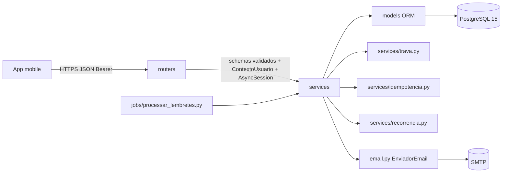
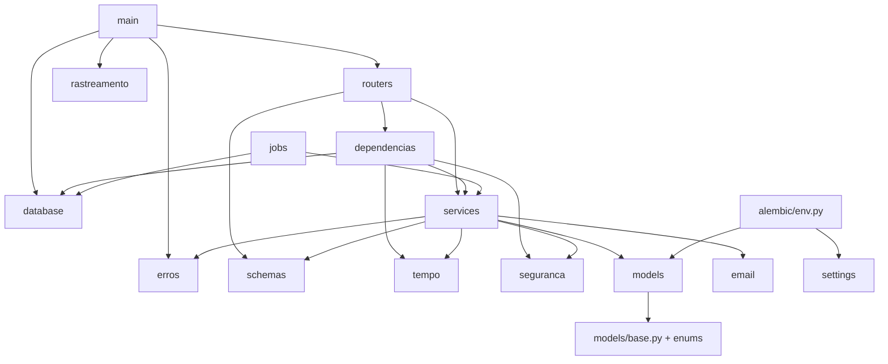
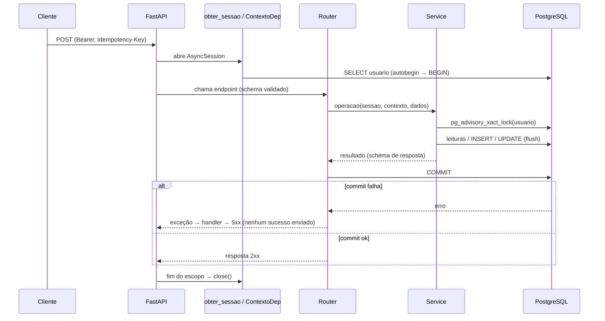

# Arquitetura da API MinhaVida

| Campo | Valor |
| --- | --- |
| Documento | `docs/arquitetura/arquitetura_api_minhavida.md` (fonte canônica dos contratos) |
| Estado | **PARCIALMENTE ACEITO** em 2026-10-11: §2 (DEC-MV-01), §4.4 (DEC-MV-03), §5 (DEC-MV-02), §3 nos itens da F1 (detalhe de D-03) e, em §10.1, somente `CONVENCAO_NOMES` e `MetaData(naming_convention=CONVENCAO_NOMES)` (DEC-MV-25). §1.1 registra instrução do usuário. As demais seções seguem PROPOSTAS, conforme `analise_projeto_minhavida.md` §9 e `indice.md` §4 |
| Data | 2026-10-09. Atualizado em 2026-10-11 (§1.1, notas em §2.2, §8.7 e §10.1) |
| Decisões | ADR-0001 (D-01 a D-16) e ADR-0002 (UUID) |

> Convenção: caminhos marcados **PLANEJADO** ainda não existem. **EXISTENTE** indica arquivo presente no baseline (`analise_projeto_minhavida.md` §3.2). Pseudocódigo e exemplos deste documento **não** são código implementado nem testado.

---

## 1. Visão geral e princípios

1. **Monólito modular em camadas** (D-01): `routers → services → models`. Os schemas Pydantic definem as fronteiras.
2. **Banco como guardião final:** constraints de PK, FK, UNIQUE e CHECK. A aplicação valida antes, mas não substitui o banco.
3. **Uma transação por requisição**, confirmada explicitamente pelo router (D-04).
4. **Trava transacional do usuário** para toda escrita e leitura composta (D-05 e D-12).
5. **Derivados nunca persistidos:** saldo, totais, situação, atraso e duração.
6. **Tempo explícito:** `Relogio` injetável e “hoje” calculado no fuso da conta (D-13).
7. **Sem I/O implícito:** sem `relationship()` na v1. Respostas montadas como schemas.



### 1.1. Escopo financeiro do produto

Instrução explícita do usuário em 2026-10-11 (REC-MV-028). O financeiro é um registro pessoal alimentado manualmente. A API calcula os totais a partir desses registros.

| Item | Regra |
| --- | --- |
| Lançamentos | O usuário cadastra, edita e exclui manualmente cada receita e cada despesa (telas 10 e 11, §8.8). O valor de um lançamento é editável |
| Totais | Receitas, despesas e saldo são **calculados** a partir dos lançamentos válidos do período (9.2.1, 9.2.2, §8.8). Não há coluna, tabela ou endpoint de saldo informado manualmente (princípio 5) |
| Alterações | Edição e exclusão de lançamentos refletem nos totais conforme as regras existentes (9.4.2, 10.5.4, 9.3.4) |
| Exemplo de referência | Receita de 3000.00 e despesas de 100.00, 50.00 e 200.00 resultam em despesas de 350.00 e saldo de 2650.00 (CT-F6-14) |
| Forma de recebimento ou pagamento | Campo apenas descritivo (10.2.3, 11.2.3). Escolher Pix, cartão ou boleto não executa nenhuma operação |
| Importâncias | O valor previsto não entra nos totais (8.5.3). “Registrar pagamento” é uma informação do usuário: cria ou vincula uma despesa, contabilizada uma única vez (§8.7, F8) |

**Fora do escopo.** Não implementar nem preparar “para uso futuro” dependências, tabelas, configurações ou abstrações destinadas a:

- conexão ou autenticação com bancos;
- Open Finance ou Open Banking;
- importação ou sincronização automática de receitas, despesas, extratos ou faturas de instituições externas;
- gateways ou processadores de pagamento;
- execução de pagamentos, Pix, transferências ou boletos;
- conciliação com saldos reais de contas bancárias.

Esses itens nunca estiveram previstos nos documentos da F0. A delimitação não afeta funcionalidades independentes, como o envio do código de recuperação de senha por e-mail (D-15).

---

## 2. Organização de módulos e dependências

### 2.1. Árvore alvo

```text
API/
├── alembic.ini                          PLANEJADO (F1)
├── alembic/                             PLANEJADO (F1)
│   ├── env.py                           async + run_sync; sem importar main
│   ├── script.py.mako
│   └── versions/                        F2: revisão inicial (13 tabelas + seeds)
├── compose.yaml                         EXISTENTE (F1: credenciais via .env, 127.0.0.1)
├── .env.exemplo                         PLANEJADO (F1, sem segredos reais)
├── src/api_gestao_pessoal/
│   ├── __init__.py                      PLANEJADO (F1)
│   ├── main.py                          EXISTENTE → criar_app(), lifespan, handlers (F1)
│   ├── settings.py                      EXISTENTE → Settings + obter_settings() (F1)
│   ├── database.py                      EXISTENTE → criar_engine, criar_fabrica_sessoes, obter_sessao, SessaoDep (F1)
│   ├── erros.py                         PLANEJADO (F1) CodigoErro, ErroNegocio, registrar_tratadores_erro
│   ├── rastreamento.py                  PLANEJADO (F1) id_requisicao (contextvar), middleware, logging
│   ├── tempo.py                         PLANEJADO (F3) Relogio, RelogioSistema, utilidades de data
│   ├── seguranca.py                     PLANEJADO (F3) HasherSenha (Argon2id), tokens JWT, carimbo sv
│   ├── email.py                         PLANEJADO (F3) EnviadorEmail, Smtp, Memoria
│   ├── dependencias.py                  PLANEJADO (F3) RelogioDep, ContextoDep, EnviadorEmailDep; F4: ChaveIdempotenciaDep
│   ├── models/
│   │   ├── __init__.py                  F1: exporta Base; F2: importa os 13 modelos
│   │   ├── base.py                      EXISTENTE (F1: naming convention; F2: CriadoAtualizadoMixin)
│   │   ├── enums.py                     F2
│   │   ├── usuario.py                   EXISTENTE (vazio) → F2
│   │   ├── recuperacao_senha.py         F2
│   │   ├── categoria_atividade.py       F2
│   │   ├── serie_atividade.py           F2
│   │   ├── atividade.py                 F2
│   │   ├── categoria_importancia.py     F2
│   │   ├── serie_importancia.py         F2
│   │   ├── importancia.py               F2
│   │   ├── categoria_financeira.py      F2
│   │   ├── movimentacao_financeira.py   F2
│   │   ├── lembrete_importancia.py      F2
│   │   ├── notificacao.py               F2
│   │   └── requisicao_idempotente.py    F2
│   ├── schemas/
│   │   ├── __init__.py                  F1
│   │   ├── erro.py                      F1  CampoErro, RespostaErro
│   │   ├── saude.py                     F1
│   │   ├── comum.py                     F4  tipos anotados (ValorMonetario, NomeTexto…), Pagina, cursores
│   │   ├── autenticacao.py, usuario.py  F3
│   │   ├── categoria.py                 F4
│   │   ├── atividade.py                 F5
│   │   ├── financeiro.py                F6 (+F8)
│   │   ├── importancia.py               F7 (+F8)
│   │   ├── notificacao.py               F9
│   │   └── painel.py                    F10
│   ├── services/
│   │   ├── __init__.py                  F3
│   │   ├── identidade.py                F3  registro, login, contexto
│   │   ├── recuperacao_senha.py         F3
│   │   ├── autorizacao.py               F3  obter_do_usuario_ou_404
│   │   ├── trava.py                     F4  travar_usuario
│   │   ├── idempotencia.py              F4  executar_idempotente
│   │   ├── paginacao.py                 F4  cursores keyset
│   │   ├── categorias.py                F4
│   │   ├── recorrencia.py               F5  cálculo puro + materialização genérica
│   │   ├── atividades.py                F5
│   │   ├── financeiro.py                F6  cadastro/edição/exclusão/consulta
│   │   ├── resumo_financeiro.py         F6  totais, gráfico, categorias, comparação
│   │   ├── situacao_importancia.py      F7  expressões SQL de situação/prazo
│   │   ├── importancias.py              F7
│   │   ├── lembretes.py                 F7  agendamento e ciclo de vida
│   │   ├── pagamentos.py                F8
│   │   ├── processamento_lembretes.py   F9
│   │   ├── notificacoes.py              F9
│   │   └── painel.py                    F10
│   ├── routers/
│   │   ├── __init__.py                  F1
│   │   ├── saude.py                     F1
│   │   ├── autenticacao.py, usuarios.py F3
│   │   ├── categorias.py                F4
│   │   ├── atividades.py                F5
│   │   ├── financeiro.py                F6 (+F8)
│   │   ├── importancias.py              F7 (+F8)
│   │   ├── notificacoes.py              F9
│   │   └── painel.py                    F10
│   └── jobs/
│       ├── __init__.py                  F9
│       └── processar_lembretes.py       F9  ponto de entrada (dono da transação)
└── tests/                               PLANEJADO (F1+) — ver plano_validacao_auditoria.md §3
```

Os arquivos existentes `routers/` (vazio) e `models/usuario.py` (vazio) são reaproveitados. `schemas/message.py` e a rota `GET /` serão removidos na F1, se DEC-MV-05 for aprovada.

### 2.2. Direção permitida das dependências



Regras:

- `models` não importa `services`, `routers`, `schemas`, `main` nem `database`.
- `services` não importa `routers`, `main`, `fastapi.Request`, `Response` nem objetos HTTP. Recebe `AsyncSession`, `ContextoUsuario`, `Relogio` e schemas validados.
- `alembic/env.py` importa somente `api_gestao_pessoal.models` (metadata) e `api_gestao_pessoal.settings` (URL padrão).
- Services de domínio podem importar os services de suporte (`trava`, `idempotencia`, `paginacao`, `recorrencia`, `situacao_importancia`, `lembretes` e `autorizacao`). Entre services de domínio, só são permitidas as importações abaixo. Nenhuma é circular.

| Service | Pode importar (domínio) |
| --- | --- |
| `pagamentos` (F8) | `financeiro`, `importancias` |
| `painel` (F10) | `atividades`, `resumo_financeiro`, `importancias`, `notificacoes` |
| `processamento_lembretes` (F9) | `importancias` (materialização) |
| `resumo_financeiro` (F6) | — (somente suporte) |
| `financeiro`, `atividades`, `importancias`, `identidade`, `recuperacao_senha`, `notificacoes` | — (somente suporte) |

- `financeiro` **nunca** importa `pagamentos`:
  - Ao excluir uma despesa vinculada, `financeiro` limpa o vínculo e chama `lembretes.ao_reabrir_importancia(...)`, um service de suporte.
  - Uma edição de despesa que altere `importancia_id` é encaminhada pelo router a `pagamentos.alterar_vinculo_despesa(...)`, conforme §8.7.
- Funções puras (cálculo de recorrência, comparação percentual e formatação de prévia) não acessam o banco e são testadas sem container.

> **Conflito registrado (REC-MV-029, ACH-MV-ARQ-021):** a regra de ADR-0001 D-02 é mais restritiva do que esta matriz. Os dois textos foram aprovados por DEC-MV-01. Até a decisão de DEC-MV-24, vale D-02, por precedência (`indice.md` §3). Nenhuma fase até a F4 é afetada. A liberação da F5 depende da decisão.

### 2.3. Onde fica cada validação

| Tipo de regra | Local |
| --- | --- |
| Forma, tipos, tamanhos, formatos, campos condicionais do próprio corpo (horário final > inicial, `possui_despesa` ↔ valor, `ATE_DATA` ↔ `data_final`, senhas iguais) | Schema Pydantic de entrada |
| Regras dependentes de tempo e fuso (data futura, lembrete futuro, “hoje”) | Service, com `ContextoUsuario` |
| Regras dependentes de estado (categoria ativa e do tipo correto, propriedade, pagamento existente, sobreposição, alcance) | Service, sob a trava do usuário |
| Integridade estrutural (unicidade, FKs compostas, CHECKs) | Banco. O service traduz as violações esperadas em `ErroNegocio` |

---

## 3. Configuração, ciclo de vida e operação básica

### 3.1. Variáveis de ambiente (`Settings`)

| Variável | Tipo / padrão | Fase | Observação |
| --- | --- | --- | --- |
| `DATABASE_URL` | `SecretStr`, obrigatório | F1 | Deve começar com `postgresql+psycopg://`. Outros esquemas são rejeitados sem eco do valor |
| `AMBIENTE` | `Literal["desenvolvimento","teste","producao"]` = `desenvolvimento` | F1 | — |
| `LOG_NIVEL` | `Literal["DEBUG","INFO","WARNING","ERROR"]` = `INFO` | F1 | — |
| `DB_POOL_SIZE` | int 1–50 = 5 | F1 | — |
| `DB_MAX_OVERFLOW` | int 0–50 = 5 | F1 | — |
| `DB_POOL_TIMEOUT_S` | float > 0 = 10 | F1 | — |
| `DB_CONNECT_TIMEOUT_S` | int 1–60 = 5 | F1 | libpq `connect_timeout` |
| `DB_STATEMENT_TIMEOUT_MS` | int ≥ 100 = 15000 | F1 | `-c statement_timeout` |
| `DB_LOCK_TIMEOUT_MS` | int ≥ 50 = 5000 | F1 | `-c lock_timeout` |
| `DB_IDLE_IN_TRANSACTION_TIMEOUT_MS` | int ≥ 1000 = 30000 | F1 | `-c idle_in_transaction_session_timeout` |
| `JWT_SEGREDO` | `SecretStr`, ≥ 32 caracteres | F3 | Obrigatório |
| `JWT_VALIDADE_MINUTOS` | int 5–10080 = 1440 | F3 | Proposta de 24 h (DEC-MV-09) |
| `ARGON2_TIME_COST` / `ARGON2_MEMORY_COST_KIB` / `ARGON2_PARALLELISM` | 3 / 65536 / 4 | F3 | Os testes usam valores baixos |
| `RECUPERACAO_VALIDADE_MINUTOS` | 10 | F3 | DEC-MV-11 |
| `RECUPERACAO_MAX_TENTATIVAS` | 5 | F3 | DEC-MV-11 |
| `RECUPERACAO_INTERVALO_REENVIO_S` | 60 | F3 | DEC-MV-11 |
| `EMAIL_MODO` | `Literal["smtp","memoria"]` = `smtp` | F3 | `memoria` é proibido com `AMBIENTE=producao` |
| `SMTP_HOST` / `SMTP_PORTA` / `SMTP_USUARIO` / `SMTP_SENHA` / `SMTP_STARTTLS` / `SMTP_REMETENTE` / `SMTP_TIMEOUT_S` | str / 587 / str / `SecretStr` / true / str / 10 | F3 | Obrigatórios quando `EMAIL_MODO=smtp` |
| `LEMBRETES_INTERVALO_S` / `LEMBRETES_LOTE` / `LEMBRETES_JANELA_DIAS` | 60 / 100 / 8 | F9 | — |

`obter_settings()` é decorada com `functools.lru_cache(maxsize=1)`. Os testes chamam `obter_settings.cache_clear()` ou injetam `Settings` em `criar_app(settings)`.

### 3.2. Engine, sessões e `lifespan`

```python
# pseudocódigo — database.py
def criar_engine(settings: Settings) -> AsyncEngine:
    opcoes = (
        f"-c statement_timeout={settings.DB_STATEMENT_TIMEOUT_MS} "
        f"-c lock_timeout={settings.DB_LOCK_TIMEOUT_MS} "
        f"-c idle_in_transaction_session_timeout={settings.DB_IDLE_IN_TRANSACTION_TIMEOUT_MS}"
    )
    return create_async_engine(
        settings.DATABASE_URL.get_secret_value(),
        hide_parameters=True, pool_pre_ping=True, pool_recycle=1800,
        pool_size=settings.DB_POOL_SIZE, max_overflow=settings.DB_MAX_OVERFLOW,
        pool_timeout=settings.DB_POOL_TIMEOUT_S,
        connect_args={"connect_timeout": settings.DB_CONNECT_TIMEOUT_S, "options": opcoes},
    )

def criar_fabrica_sessoes(engine) -> async_sessionmaker[AsyncSession]:
    return async_sessionmaker(engine, expire_on_commit=False, autoflush=False)

async def obter_sessao(request: Request) -> AsyncIterator[AsyncSession]:
    fabrica = request.app.state.fabrica_sessoes
    async with fabrica() as sessao:
        yield sessao          # sem commit aqui; close() desfaz o que não foi confirmado

SessaoDep = Annotated[AsyncSession, Depends(obter_sessao, scope="function")]
```

```python
# pseudocódigo — main.py
def criar_app(settings: Settings | None = None) -> FastAPI:
    @asynccontextmanager
    async def ciclo_de_vida(app: FastAPI):
        s = settings or obter_settings()
        configurar_logging(s.LOG_NIVEL)
        engine = criar_engine(s)
        app.state.settings = s
        app.state.engine = engine
        app.state.fabrica_sessoes = criar_fabrica_sessoes(engine)
        try:
            yield
        finally:
            await engine.dispose()
    app = FastAPI(title="API MinhaVida", version="0.1.0", lifespan=ciclo_de_vida)
    app.middleware("http")(middleware_id_requisicao)
    registrar_tratadores_erro(app)
    app.include_router(routers.saude.router)
    # fases seguintes: include_router(..., prefix="/api/v1")
    return app

app = criar_app()   # sem I/O: settings só são lidas no lifespan
```

### 3.3. Saúde

| Rota | Comportamento |
| --- | --- |
| `GET /saude` | 200 `{"situacao": "ativo"}`. Sem banco |
| `GET /saude/pronto` | Executa `SELECT 1` com `app.state.engine.connect()` e timeout de 2 s (`asyncio.timeout`). Sucesso: 200 `{"situacao": "pronto"}`. Falha: 503 com `codigo = SERVICO_INDISPONIVEL`. Não usa `obter_sessao` |

### 3.4. Rastreamento e logs

- Middleware `middleware_id_requisicao`: usa `X-Request-ID` recebido, se casar com `^[A-Za-z0-9-]{8,64}$`. Caso contrário, gera `uuid.uuid4().hex`. Guarda o valor em `ContextVar` e devolve o cabeçalho `X-Request-ID` na resposta.
- O logging da aplicação (logger `api_gestao_pessoal`) tem um filtro que injeta `id_requisicao`. Formato: `%(asctime)s %(levelname)s %(name)s [%(id_requisicao)s] %(message)s`.
- **Proibido logar:**
  - corpos de requisição;
  - senhas, hashes, códigos e tokens;
  - e-mails e nomes.

  Identificar o usuário somente por `usuario_id`.
- `hide_parameters=True` na engine (MANTER). Assim, parâmetros SQL não aparecem em mensagens de exceção.
  - **Limite:** `hide_parameters` não cobre as mensagens do PostgreSQL. O `DETAIL` (por exemplo, `Key (email)=(…)`) e `Failing row contains (…)` podem conter valores de colunas, inclusive a linha inteira.
  - Por isso, o handler de `DBAPIError` registra o 500 com `logger.error` sem `exc_info`, só com identificadores (`sqlstate`, classe, esquema, tabela, coluna e restrição) e a pilha sem mensagens. Os 503 registram só o código. O handler genérico mantém o traceback (CT-F1-09).
  - Atualizado em 2026-10-11 (P-DOC-03, ACH-MV-F1-002), com aprovação do usuário.

---

## 4. Contratos HTTP transversais

### 4.1. Convenções

| Item | Regra |
| --- | --- |
| Prefixo | `/api/v1` para negócio. `/saude` fora do prefixo |
| Formato | JSON UTF-8. Campos em `snake_case` PT-BR. Valores técnicos de enum (`MEDIA`, `CARTAO_DEBITO`) |
| Identificadores | UUID canônico (ADR-0002) |
| Data civil | `YYYY-MM-DD`. A apresentação DD/MM/AAAA é responsabilidade do cliente |
| Horário | Entrada e saída `HH:MM` (regex `^([01]\d\|2[0-3]):[0-5]\d$`). Segundos não são aceitos |
| Instante | ISO 8601 em UTC com sufixo `Z` |
| Mês | Parâmetro `mes=YYYY-MM` |
| Dinheiro | String decimal: entrada `^\d{1,10}(\.\d{1,2})?$` e > 0. Saída sempre com 2 casas (`"1220.35"`). Número JSON é rejeitado (D-16) |
| Atualização parcial (PATCH) | Campo ausente = sem alteração. `null` só é aceito em campos anuláveis (`descricao`, `horario`, `contraparte`, `forma`, `lembrete`, `importancia_id`) e significa “remover”. `null` em campo obrigatório resulta em 422. Implementação: `model_fields_set` |
| Paginação | `limite` 1–50 (padrão 20) e `cursor` opaco. Resposta com `proximo_cursor` (`null` no fim). Cursor = base64url de `{"v":1,"o":<ordenacao>,"f":<8 hex do SHA-256 dos filtros>,"k":[chaves...]}`. Se o cursor não corresponder aos filtros atuais: 422 `CURSOR_INVALIDO` |
| Totais | Sempre sobre o universo completo dos filtros, por consulta agregada separada da página (D-12) |
| Cabeçalhos de entrada | `Authorization: Bearer <jwt>`, `Idempotency-Key`, `X-Request-ID` |
| Cabeçalhos de saída | `X-Request-ID`, `Idempotency-Replayed: true` (replay), `Retry-After` (429/503), `WWW-Authenticate: Bearer` (401) |

### 4.2. Autenticação e autorização

- Dependência `ContextoDep`, que obtém `ContextoUsuario`. Passos:
  1. Lê o Bearer e decodifica com `PyJWT`: `algorithms=["HS256"]`, exige `exp`, `iat`, `sub` e `sv`, com `typ == "access"`.
  2. Carrega o `usuario` por `id = UUID(sub)` na `SessaoDep`.
  3. Compara `sv` com `carimbo(senha_hash)` usando `hmac.compare_digest`.
  4. Monta `ContextoUsuario(usuario_id, nome_completo, fuso=ZoneInfo(fuso_horario), agora=relogio.agora(), hoje=agora.astimezone(fuso).date())`.

  Qualquer falha resulta em 401 `NAO_AUTENTICADO`.
- `carimbo(senha_hash) = sha256(senha_hash.encode()).hexdigest()[:16]`.
- Recursos por ID: `services/autorizacao.py::obter_do_usuario_ou_404(sessao, Modelo, id, usuario_id, *, incluir_excluidos=False)`. Filtra por `usuario_id`. Na ausência, lança `ErroNegocio(RECURSO_NAO_ENCONTRADO)`. Recursos de outro usuário são indistinguíveis de inexistentes.
- `usuario_id` **nunca** vem do corpo, da query ou do caminho.

### 4.3. Idempotência (transporte)

| Endpoint | `acao` | Status de sucesso |
| --- | --- | --- |
| `POST /api/v1/atividades` | `CADASTRAR_ATIVIDADE` | 201 |
| `POST /api/v1/importancias` | `CADASTRAR_IMPORTANCIA` | 201 |
| `POST /api/v1/financeiro/receitas` | `CADASTRAR_RECEITA` | 201 |
| `POST /api/v1/financeiro/despesas` (com ou sem `importancia_id`) | `CADASTRAR_DESPESA` | 201 |

- `Idempotency-Key` é **obrigatório** nesses endpoints. Ausente: 400 `IDEMPOTENCIA_CHAVE_AUSENTE`. Formato inválido (`^[A-Za-z0-9_-]{16,64}$`): 400 `IDEMPOTENCIA_CHAVE_INVALIDA`.
- O cliente gera uma chave nova por **intenção de cadastro** (por exemplo, UUID ao abrir o formulário) e a reutiliza em todas as novas tentativas do mesmo envio.
- Endpoints naturalmente idempotentes, sem chave:
  - `PATCH`;
  - `PUT …/situacao`;
  - `DELETE`;
  - `PUT /importancias/{id}/pagamento` (vincular o mesmo par);
  - `POST /notificacoes/{id}/leitura`.
- Protocolo de servidor: §8.4.

### 4.4. Erros

Formato único (`schemas/erro.py`):

```json
{
  "codigo": "VALIDACAO",
  "mensagem": "Dados inválidos.",
  "campos": [{"campo": "nome", "codigo": "NOME_OBRIGATORIO", "mensagem": "Informe o nome da atividade"}],
  "detalhes": null,
  "id_requisicao": "3f2c9a…"
}
```

- `campo` é o caminho sem o prefixo de origem: `("body","repeticao","data_final")` → `"repeticao.data_final"`. Para cabeçalhos: `"Idempotency-Key"`.
- **O valor de entrada nunca é ecoado**, nem o `ctx` bruto. O handler monta a mensagem a partir do código.
- Mapeamento de erros Pydantic (handler de `RequestValidationError`):

| Tipo Pydantic | `campos[].codigo` | Mensagem |
| --- | --- | --- |
| tipo em `UPPER_SNAKE` (`PydanticCustomError` nosso) | o próprio tipo | `msg` do erro (mensagem literal do requisito) |
| `missing` | `OBRIGATORIO` | “Campo obrigatório.” |
| `string_too_short` / `string_too_long` | `TAMANHO_MINIMO` / `TAMANHO_MAXIMO` | “Informe pelo menos {n} caracteres.” / “Informe no máximo {n} caracteres.” |
| prefixo `date_` | `DATA_INVALIDA` | “Informe uma data válida” (6.5.2) |
| prefixo `time_` | `HORARIO_INVALIDO` | “Informe um horário válido” |
| `uuid_*` | `FORMATO_INVALIDO` | “Identificador inválido.” |
| `enum`, `literal_error` | `VALOR_NAO_PERMITIDO` | “Valor não permitido.” |
| `json_invalid` | — (erro de topo `CORPO_INVALIDO`) | “Corpo da requisição inválido.” |
| outros | `FORMATO_INVALIDO` | “Formato inválido.” |

- **Mensagens literais dos requisitos** em campos obrigatórios de negócio: os schemas usam o padrão `Field(default=None, validate_default=True)` com `BeforeValidator`, que lança `PydanticCustomError("<CODIGO>", "<mensagem literal>")` quando o valor é ausente ou vazio. Exemplos:
  - “Informe o nome da atividade”;
  - “Selecione uma categoria”;
  - “Informe um valor recebido maior que zero”.

  O catálogo completo está em §4.5.

Catálogo de códigos de topo (`CodigoErro`):

| Código | HTTP | Mensagem padrão | Fase |
| --- | --- | --- | --- |
| `VALIDACAO` | 422 | Dados inválidos. | F1 |
| `CORPO_INVALIDO` | 422 | Corpo da requisição inválido. | F1 |
| `RECURSO_NAO_ENCONTRADO` | 404 | Recurso não encontrado. | F1 |
| `METODO_NAO_PERMITIDO` | 405 | Método não permitido. | F1 |
| `ERRO_HTTP` | variável | Não foi possível processar a requisição. | F1 |
| `CONFLITO_CONCORRENCIA` | 503 (+`Retry-After: 1`) | Não foi possível concluir a operação agora. Tente novamente. | F1 |
| `TEMPO_ESGOTADO` | 503 | A operação demorou mais que o esperado. Tente novamente. | F1 |
| `SERVICO_INDISPONIVEL` | 503 | Serviço indisponível. | F1 |
| `ERRO_INTERNO` | 500 | Ocorreu um erro inesperado. Tente novamente. | F1 |
| `NAO_AUTENTICADO` | 401 | Sessão inválida ou expirada. Entre novamente. | F3 |
| `CREDENCIAIS_INVALIDAS` | 401 | E-mail ou senha inválidos. | F3 |
| `EMAIL_JA_CADASTRADO` | 409 | Este e-mail já está cadastrado. | F3 |
| `EMAIL_NAO_ENCONTRADO` | 404 | Não foi possível encontrar seu email. (3.4.2, DEC-MV-10) | F3 |
| `REENVIO_MUITO_FREQUENTE` | 429 | Aguarde alguns instantes para solicitar um novo código. | F3 |
| `FALHA_ENVIO_EMAIL` | 503 | Não foi possível enviar o código. Tente novamente. | F3 |
| `CODIGO_INVALIDO` | 400 | O código de verificação que você inseriu não é válido. Verifique o código e tente novamente. (3.4.8) | F3 |
| `CODIGO_EXPIRADO` | 400 | O código expirou. Solicite um novo código. | F3 |
| `TENTATIVAS_ESGOTADAS` | 429 | Limite de tentativas atingido. Solicite um novo código. | F3 |
| `CODIGO_JA_VERIFICADO` | 409 | Este código já foi utilizado. Solicite um novo código. | F3 |
| `TOKEN_REDEFINICAO_INVALIDO` | 400 | A solicitação de redefinição expirou ou é inválida. Solicite um novo código. | F3 |
| `IDEMPOTENCIA_CHAVE_AUSENTE` | 400 | Cabeçalho Idempotency-Key obrigatório. | F4 |
| `IDEMPOTENCIA_CHAVE_INVALIDA` | 400 | Cabeçalho Idempotency-Key inválido. | F4 |
| `CHAVE_IDEMPOTENCIA_REUTILIZADA` | 422 | Esta chave de idempotência já foi usada com outro conteúdo. | F4 |
| `CURSOR_INVALIDO` | 422 | Cursor de paginação inválido. | F4 |
| `SOBREPOSICAO_HORARIO` | 409 | Este horário se sobrepõe a outra atividade. (`detalhes.conflitos`) | F5 |
| `ALCANCE_INVALIDO` | 422 | Ocorrências concluídas só podem ser alteradas individualmente. | F5 |
| `REPETICAO_EXIGE_ALCANCE_SERIE` | 422 | Para alterar a repetição, escolha “Esta e as próximas pendentes”. | F5 |
| `CONCLUSAO_EXIGE_PAGAMENTO` | 409 | Importâncias com despesa são concluídas pelo registro do pagamento. | F7 |
| `REABERTURA_EXIGE_REMOVER_PAGAMENTO` | 409 | Para reabrir uma importância paga, exclua ou desvincule a despesa. | F7/F8 |
| `IMPORTANCIA_CONCLUIDA_SEM_ALTERAR_DESPESA` | 409 | Reabra a importância antes de alterar “Possui despesa?”. | F7 |
| `IMPORTANCIA_PAGA_SEM_ALTERAR_DESPESA` | 409 | Esta importância possui pagamento vinculado. Altere o pagamento em “Ver despesa”. | F8 |
| `IMPORTANCIA_JA_PAGA` | 409 | Esta importância já possui um pagamento registrado (11.5.4). `detalhes.movimentacao_id` | F8 |
| `DESPESA_JA_VINCULADA` | 409 | Esta despesa já está vinculada a outra importância. | F8 |
| `IMPORTANCIA_SEM_DESPESA` | 409 | Esta importância não possui despesa. | F8 |
| `CONFIRMACAO_VINCULO_NECESSARIA` | 409 | Confirme a alteração do vínculo: a importância anterior voltará a ficar pendente. | F8 |

Mapeamento de exceções de banco (`DBAPIError`, por `exc.orig.sqlstate`):

| SQLSTATE | Resposta |
| --- | --- |
| `40001`, `40P01`, `55P03` | 503 `CONFLITO_CONCORRENCIA` |
| `57014` | 503 `TEMPO_ESGOTADO` |
| Demais, inclusive `IntegrityError` não traduzida pelo service | 500 `ERRO_INTERNO`. Indica defeito: o service deveria ter traduzido a violação |

### 4.5. Catálogo de mensagens de campo

As mensagens literais vêm dos requisitos. As marcadas com † são propostas (o requisito não fixa o texto).

| Contexto | `campos[].codigo` | Mensagem |
| --- | --- | --- |
| Senha (registro e redefinição) | `SENHA_FRACA` | A senha informada não atende os requisitos necessários de 8 caracteres (3.4.10) |
| Senha | `SENHAS_DIFERENTES` | As senhas devem ser idênticas (3.4.14) |
| E-mail | `EMAIL_INVALIDO` | Informe um e-mail válido† |
| Código | `CODIGO_FORMATO` | O código deve conter 8 dígitos numéricos† |
| Nascimento | `DATA_NASCIMENTO_FUTURA` | A data de nascimento não pode ser futura† |
| Fuso | `FUSO_INVALIDO` | Fuso horário inválido† |
| Atividade | `NOME_OBRIGATORIO` | Informe o nome da atividade (6.5.1) |
| Atividade, importância, receita, despesa | `CATEGORIA_OBRIGATORIA` | Selecione uma categoria (6.5.1, 8.6.1, 10.5.1) |
| Qualquer categoria inexistente, inativa ou de outro tipo | `CATEGORIA_INVALIDA` | Selecione uma categoria válida† |
| Datas | `DATA_INVALIDA` | Informe uma data válida (6.5.2, 8.6.1, 10.5.1) |
| Horários | `HORARIO_FINAL_INVALIDO` | O horário final deve ser posterior ao horário inicial (6.5.2) |
| Repetição | `DATA_FINAL_OBRIGATORIA` / `DATA_FINAL_REPETICAO_INVALIDA` | Informe a data final da repetição† / A data final da repetição não pode ser anterior à primeira ocorrência† |
| Importância | `NOME_OBRIGATORIO` | Informe o nome da importância (8.6.1) |
| Importância | `VALOR_PREVISTO_OBRIGATORIO` | Informe um valor previsto maior que zero (8.6.2) |
| Importância | `LEMBRETE_NO_PASSADO` | O lembrete precisa estar em uma data e horário futuros. Ajuste ou desative o lembrete† (8.5.5) |
| Receita | `NOME_OBRIGATORIO` / `VALOR_OBRIGATORIO` | Informe o nome da receita / Informe um valor recebido maior que zero (10.5.1) |
| Despesa | `NOME_OBRIGATORIO` / `VALOR_OBRIGATORIO` | Informe o nome da despesa† / Informe um valor pago maior que zero† |
| Dinheiro | `CASAS_DECIMAIS` | Informe um valor com até duas casas decimais (10.5.2) |
| Dinheiro | `VALOR_ACIMA_DO_LIMITE` | O valor máximo por lançamento é R$ 9.999.999.999,99† |
| Receita | `DATA_FUTURA` | A data do recebimento não pode ser futura (10.5.2) |
| Despesa | `DATA_FUTURA` | A data do pagamento não pode ser futura. Cadastre o compromisso em Importâncias (11.6.1) |
| Forma | `FORMA_INCOMPATIVEL` | Forma não disponível para este tipo de lançamento† |

---

## 5. Transações e ciclo de sessão (D-04)

### 5.1. Responsabilidades

| Ator | Pode | Não pode |
| --- | --- | --- |
| `obter_sessao` | Abrir e fechar a sessão (o `close` desfaz o que não foi confirmado) | `commit`, `begin` |
| Dependências (`ContextoDep` etc.) | Consultar na `SessaoDep` (o autobegin inicia a transação da requisição) | Escrever, `commit` |
| Router | Chamar services, `await sessao.commit()` como último passo, montar a resposta e lançar `ErroNegocio` após um commit deliberado (§5.3) | Regras de negócio, consultas SQL |
| Service | Consultar, `add`, `flush`, `begin_nested` (somente em caso documentado), lançar `ErroNegocio` e retornar resultados | `commit`, `rollback`, `begin`, `close`, objetos HTTP |
| Job (`jobs/*.py`) | Abrir sessão própria (`async with fabrica() as s`), chamar services, `commit` por unidade de trabalho | Compartilhar sessão entre tarefas concorrentes |

### 5.2. Sequência padrão de escrita



Regras:

1. Nenhum endpoint de escrita retorna sem `await sessao.commit()`. Isso inclui os GET que materializam ocorrências. Cada CT de endpoint verifica a persistência por **outra conexão**.
2. Em `ErroNegocio` ou exceção, o router não faz commit. `close()` desfaz tudo, inclusive a trava (que é transacional).
3. Depois de um `IntegrityError`, a transação está abortada. O service só pode traduzir o erro e relançá-lo. Para continuar após um conflito esperado, a instrução deve estar dentro de `async with sessao.begin_nested():` (SAVEPOINT). Hoje nenhum fluxo precisa disso: a trava do usuário e o `ON CONFLICT` evitam conflitos esperados.
4. Isolamento: `READ COMMITTED` (padrão do PostgreSQL) em todas as operações. A consistência entre instruções vem da trava do usuário (§6.4).
5. Respostas são schemas Pydantic montados pelos services ou pelo router a partir de valores já carregados (`expire_on_commit=False` e `eager_defaults=True`). Não há `relationship()`, portanto não há I/O implícito na serialização.

### 5.3. Exceção controlada: persistir e depois recusar

Usada **somente** na verificação de código de recuperação (§8.3.2):

```python
# pseudocódigo — routers/autenticacao.py
resultado = await recuperacao_senha.verificar_codigo(sessao, dados, relogio, settings)
await sessao.commit()                      # persiste tentativas+1 OU verificado_em/token
if resultado.erro is not None:
    raise ErroNegocio(resultado.erro)      # CODIGO_INVALIDO / TENTATIVAS_ESGOTADAS / ...
return VerificacaoCodigoResposta(token_redefinicao=resultado.token, expira_em=resultado.expira_em)
```

O service retorna `ResultadoVerificacao(erro: CodigoErro | None, token: str | None, expira_em: datetime | None)` e nunca lança exceção para os resultados esperados. Nenhum handler faz commit.

### 5.4. Jobs

`jobs/processar_lembretes.py` cria a engine pela `Settings`. Cada unidade (uma série a materializar ou um lembrete a processar) roda em `async with fabrica() as s:`, com `await s.commit()` ao fim. Uma falha numa unidade desfaz apenas aquela unidade.

---

## 6. Concorrência (D-05)

### 6.1. Trava transacional do usuário

```python
# pseudocódigo — services/trava.py
class ModoTrava(StrEnum):
    EXCLUSIVA = "EXCLUSIVA"
    COMPARTILHADA = "COMPARTILHADA"

async def travar_usuario(sessao: AsyncSession, usuario_id: UUID, modo: ModoTrava) -> None:
    atual = sessao.info.get("trava_usuario")              # (usuario_id, modo) ou None
    if atual is not None:
        if atual[0] != usuario_id:
            raise RuntimeError("trava de outro usuário já adquirida nesta sessão")
        if atual[1] == ModoTrava.COMPARTILHADA and modo == ModoTrava.EXCLUSIVA:
            raise RuntimeError("promoção de trava compartilhada para exclusiva é proibida")
        return                                             # reentrância: no-op
    funcao = "pg_advisory_xact_lock" if modo == ModoTrava.EXCLUSIVA else "pg_advisory_xact_lock_shared"
    await sessao.execute(text(f"SELECT {funcao}(hashtextextended(:chave, 0))"),
                         {"chave": f"minhavida:usuario:{usuario_id}"})
    sessao.info["trava_usuario"] = (usuario_id, modo)
```

- O registro em `sessao.info` é limpo após commit e rollback por listeners de sessão: `after_commit`, `after_rollback` e `after_soft_rollback` sobre `Session`.
- Modo é decidido no início da operação e **nunca promovido**.

| Operação | Modo |
| --- | --- |
| Toda escrita de atividades, séries, importâncias, movimentações, lembretes (configuração), idempotência e marcação de notificação como lida | EXCLUSIVA |
| Consultas que materializam (lista de atividades, pendências anteriores, lista de importâncias exceto Concluídos, blocos do painel de atividades e importâncias) | EXCLUSIVA |
| Leituras compostas sem materialização (resumo financeiro, lista de movimentações, painel financeiro, importâncias Concluídos, detalhes) | COMPARTILHADA |
| Leitura de registro único sem agregação (`GET /usuarios/me`, `GET /notificacoes/nao-lidas`) | Nenhuma |

### 6.2. Travas de linha

| Recurso | Uso |
| --- | --- |
| `recuperacao_senha` | `SELECT … FOR UPDATE` pela linha do usuário (solicitar e verificar) ou pelo `token_redefinicao_hash` (redefinir). O fluxo não é autenticado e não usa a trava do usuário |
| `lembrete_importancia` (processador) | `SELECT … WHERE situacao='PENDENTE' AND agendado_para <= :agora ORDER BY agendado_para, id LIMIT 1 FOR UPDATE SKIP LOCKED` |
| `lembrete_importancia` (API) | `UPDATE … WHERE id=:id AND situacao=:esperada [AND versao_agendamento=:v]`. A atualização condicional espera a trava de linha do processador, e o `READ COMMITTED` reavalia o `WHERE` |

### 6.3. Ordem de aquisição e deadlocks

1. A API adquire **primeiro** a trava do usuário e depois toca linhas: o UPDATE condicional de lembrete é a única espera por linha. Nunca toma `FOR UPDATE` em importância ou movimentação, porque a trava do usuário já serializa.
2. O processador de lembretes, na etapa 2, trava a linha do lembrete e **apenas lê** a importância, sem travá-la. Nunca adquire a trava do usuário nessa etapa.
3. O processador, na etapa 1 (materialização), adquire somente a trava do usuário, numa transação separada.
4. A recuperação de senha trava somente a linha de `recuperacao_senha`, e depois atualiza `usuario` (redefinição). Nenhum outro fluxo trava `recuperacao_senha`.

Pelas regras 1–4, não há ciclo de espera possível entre os fluxos. Um deadlock (`40P01`) indicaria violação de regra: resposta 503 e log de erro.

### 6.4. Leitura consistente (D-12)

- Toda escrita de dados de um usuário detém a trava EXCLUSIVA até o commit. Uma leitura composta com trava COMPARTILHADA, ou EXCLUSIVA quando materializa, só começa quando nenhuma escrita do usuário está em andamento e impede novas escritas até terminar.
- Portanto, as várias instruções `READ COMMITTED` da leitura enxergam o mesmo estado confirmado.
- **Exceção delimitada:** a etapa 2 do processador altera somente `lembrete_importancia.situacao`/`enviado_em` e insere `notificacao`. Nenhum indicador de tela depende desses campos, exceto a contagem de não lidas, que é uma instrução única.
- Garantia testável (CT-F5-27, CT-F6-20 e CT-F10-07): uma escrita concorrente aguarda a leitura, ou a leitura aguarda a escrita. O resultado da leitura corresponde integralmente ao estado anterior ou ao posterior.

### 6.5. Timeouts e novas tentativas

| Situação | Comportamento |
| --- | --- |
| `lock_timeout` (5 s) ou deadlock | 503 `CONFLITO_CONCORRENCIA` com `Retry-After: 1`. O servidor não repete automaticamente. O cliente repete com a mesma `Idempotency-Key` (cadastros) ou com o mesmo estado alvo (operações naturalmente idempotentes) |
| `statement_timeout` (15 s) | 503 `TEMPO_ESGOTADO` |
| Jobs | A unidade que falhou é desfeita, registrada em log e retomada no ciclo seguinte. Sem retentativa imediata |

### 6.6. Matriz de operações críticas

Esta matriz cobre os passos de cada operação crítica. A coluna de resultado concorrente descreve o comportamento entre duas transações independentes.

| # | Operação / corrida | Pré-condições e leituras | Escritas | Dono da transação | Sequência de travas e validações | Constraint final | Resultado concorrente | Rollback | Teste |
| --- | --- | --- | --- | --- | --- | --- | --- | --- | --- |
| 1 | Dois cadastros com o mesmo e-mail normalizado | E-mail normalizado. Sem conta | `INSERT usuario` | Router registro | Sem trava (ainda não há usuário). `flush`. `IntegrityError` em `uq_usuario_email` é traduzido para `EMAIL_JA_CADASTRADO` | `uq_usuario_email` | Uma conta (201). A outra transação espera o índice único e recebe 409 | Total | CT-F3-05 |
| 2 | Reenvio, verificação e redefinição simultâneos | Linha de recuperação | UPDATE da linha. UPDATE de usuário (redefinir) | Routers de recuperação | `FOR UPDATE` na linha (por `usuario_id` ou hash do token). Revalidação de prazo, tentativas, verificado e utilizado após obter a trava | `uq_recuperacao_senha_usuario_id`, `uq_…_token_redefinicao_hash` | Serializados. O reenvio confirmado invalida o código anterior. O token é consumido uma vez. As tentativas são contadas exatamente | Total | CT-F3-14, CT-F3-15, CT-F3-17, CT-F3-19 |
| 3 | Duas requisições com a mesma chave idempotente | — | `requisicao_idempotente` e efeito de negócio | Router + `executar_idempotente` | Trava EXCLUSIVA → `INSERT … ON CONFLICT DO NOTHING RETURNING` → operação → `UPDATE CONCLUIDA` | `uq_requisicao_idempotente_usuario_id_acao_chave` | Um efeito. A segunda espera a trava e recebe replay idêntico, com `Idempotency-Replayed` | Total (o registro some junto) | CT-F4-05 |
| 4 | Mesma chave com conteúdo diferente | Registro existente | Nenhuma | Idem | Idem. Hash diferente → 422 | Idem | Rejeição estável, sem segundo efeito | — | CT-F4-04, CT-F4-06 |
| 5 | Duas gerações da mesma série | Série | `INSERT` de ocorrências | Router de consulta | Trava EXCLUSIVA → `INSERT … ON CONFLICT (serie_id, numero_ocorrencia) DO NOTHING` | `uq_<tabela>_serie_id_numero_ocorrencia` | Uma linha por posição | Total | CT-F5-24, CT-F7-17 |
| 6 | Geração concorrente com edição ou exclusão por alcance | Série e ocorrências | Regra, ocorrências e `numero_final` | Router | Trava EXCLUSIVA nos dois fluxos. A geração lê a regra **depois** de obter a trava | Idem | A geração anterior ou posterior à alteração vê uma regra coerente. Exclusões (lápides) nunca são recriadas | Total | CT-F5-25 |
| 7 | Conclusão concorrente com edição ou exclusão de série | Ocorrência | `concluida_em` / exclusões | Router | Trava EXCLUSIVA. A exclusão “esta e próximas” filtra `concluida_em IS NULL` após obter a trava | CHECKs | A concluída antes da exclusão é preservada. Se a exclusão vem antes, a conclusão encontra a ocorrência excluída → 404 | Total | CT-F5-26 |
| 8 | Dois pagamentos para uma importância | Importância pendente com despesa | `INSERT movimentacao` com vínculo e cancelamento do lembrete | Router de despesas | Trava EXCLUSIVA → revalida “sem pagamento ativo” → INSERT → `flush` | `uq_movimentacao_financeira_importancia_id` | Um 201. O outro recebe 409 `IMPORTANCIA_JA_PAGA` com `movimentacao_id`. Uma única despesa | Total | CT-F8-05 |
| 9 | Uma despesa vinculada simultaneamente a dois compromissos | Despesa sem vínculo | UPDATE do vínculo | Router de vínculo | Trava EXCLUSIVA → revalida `importancia_id IS NULL` | Coluna única por linha | Uma importância quitada. A outra recebe 409 `DESPESA_JA_VINCULADA` | Total | CT-F8-06 |
| 10 | Exclusão de movimentação durante vínculo ou alteração de pagamento | — | `excluida_em` e limpeza do vínculo; reativação do lembrete | Router | Trava EXCLUSIVA nos dois | `ck_movimentacao_financeira_excluida_sem_vinculo` | Ordem serial. Nunca há vínculo ativo em movimentação excluída. A importância fica coerente com o vínculo resultante | Total | CT-F8-07 |
| 11 | Exclusão de importância durante pagamento | — | Exclusão da importância e desvinculação; ou pagamento | Router | Trava EXCLUSIVA. O pagamento exige importância não excluída | FK composta | Se o pagamento vem antes, a exclusão preserva a despesa e desvincula. Se a exclusão vem antes, o pagamento recebe 404. Nunca há vínculo com importância excluída | Total | CT-F8-08 |
| 12 | Troca de importância vinculada | Despesa e importâncias A e B | Vínculo; lembretes de A e B | Router de edição de despesa | Trava EXCLUSIVA (única, sem ordem a respeitar) | `uq_…_importancia_id` | A pendente, B paga, numa operação atômica. Sem deadlock | Total | CT-F8-09 |
| 13 | Dois processadores do mesmo lembrete | Lembrete PENDENTE vencido | `INSERT notificacao` e `ENVIADO` | Job (por item) | `FOR UPDATE SKIP LOCKED` → revalida versão e situação → INSERT → UPDATE condicional | `uq_notificacao_lembrete_id_versao_agendamento` | Uma notificação por versão | Item | CT-F9-04 |
| 14 | Reagendamento, conclusão ou exclusão durante processamento | Lembrete | Versão nova ou `CANCELADO` | API e job | A API espera a trava de linha do job (UPDATE condicional). O job usa `SKIP LOCKED` quando a API detém a linha | Idem | Linearizável: ou a notificação da versão antiga sai antes da alteração, ou a versão nova ou cancelada é vista pelo job e nada é emitido para a antiga | Item / total | CT-F9-05, CT-F9-06 |
| 15 | Leitura de indicadores durante alterações financeiras | — | — | Router de leitura | Trava COMPARTILHADA | — | Resultado integralmente “antes” ou “depois” | — | CT-F6-20, CT-F5-27, CT-F10-07 |

---

## 7. Tempo e fuso (D-13)

- `tempo.py`:
  - `class Relogio(Protocol): def agora(self) -> datetime`;
  - `RelogioSistema.agora() = datetime.now(UTC)`;
  - `RelogioFixo(instante)` nos testes, com método `avancar(timedelta)`.
- `RelogioDep` fornece o relógio da aplicação (os testes usam `app.dependency_overrides`). O job recebe o relógio por parâmetro.
- `ContextoUsuario.agora` é capturado **uma vez** por requisição. Todos os cálculos da operação usam esse mesmo instante e o `hoje` derivado.
- Funções puras:
  - `primeiro_dia_mes(d)`;
  - `ultimo_dia_mes(ano, mes)` (via `calendar.monthrange`);
  - `somar_meses(ano, mes, k)`;
  - `bissexto(ano)`;
  - `instante_local(data, horario, fuso) -> datetime UTC` (via `datetime.combine(…, tzinfo=fuso).astimezone(UTC)`, `fold=0`).
- `DATE` é comparada como data civil, sem conversão.
- `usuario.fuso_horario` é validado na entrada com `zoneinfo.ZoneInfo(chave)` dentro de `try`, rejeitando `ZoneInfoNotFoundError` e chaves com `/..` ou absolutas. `tzdata` passa a ser dependência direta na F3.
- Origem dos instantes:
  - `criado_em`, `atualizado_em` e `criada_em`: `now()` do banco, no início da transação.
  - `concluida_em`, `excluida_em`, `importancia_vinculada_em`, `concluida_manualmente_em`, `verificado_em`, `utilizado_em`, `expira_em`, `agendado_para`, `enviado_em`, `lida_em` e `concluida_em` (idempotência): `contexto.agora` (relógio da aplicação).

  Comparações ocorrem sempre dentro da mesma origem.

---

## 8. Algoritmos de domínio

> Os algoritmos estão em pseudocódigo. A trava citada é sempre a de §6.1. “Flush” indica o ponto em que violações de constraint são detectadas e traduzidas.

### 8.1. Situações derivadas

**Atividade** (registro com `excluida_em IS NULL`):

- `situacao = CONCLUIDA` se `concluida_em IS NOT NULL`; senão `PENDENTE`.
- `duracao_minutos = (horario_final − horario_inicial)` em minutos. Os horários não têm segundos, então o valor é inteiro.

**Importância** (expressões SQL em `services/situacao_importancia.py`):

```sql
-- m: movimentação vinculada (no máximo 1, por uq_movimentacao_financeira_importancia_id;
--    movimentação excluída nunca mantém vínculo, por ck_movimentacao_financeira_excluida_sem_vinculo)
FROM importancia i
LEFT JOIN movimentacao_financeira m ON m.importancia_id = i.id
-- concluida
CASE WHEN i.possui_despesa THEN m.id IS NOT NULL ELSE i.concluida_manualmente_em IS NOT NULL END
-- pago
(i.possui_despesa AND m.id IS NOT NULL)
-- momento_conclusao
CASE WHEN i.possui_despesa THEN m.importancia_vinculada_em ELSE i.concluida_manualmente_em END
-- dias_ate_vencimento (somente pendentes)
(i.data_compromisso - :hoje)              -- inteiro (date - date no PostgreSQL)
```

| Regra | Definição |
| --- | --- |
| Atrasada | Pendente com `data_compromisso < hoje`. Concluída nunca é atrasada. O horário não interfere (7.3.1) |
| Prazo | `dias = 0` → `HOJE`; `1` → `AMANHA`; `> 1` → `EM_DIAS`; `< 0` → `ATRASADA`. O texto (“Em X dias”, “Atrasada há X dias”) é montado pelo cliente a partir de `dias_ate_vencimento` |
| Valor exibido | Pendente: `valor_previsto` (ou “Sem despesa” se `possui_despesa = false`). Paga: `m.valor`. Os detalhes trazem ambos |
| Ordenação horária com nulos por último | Chave `COALESCE(i.horario, TIME '24:00')`. `24:00` é válido no tipo `time` do PostgreSQL e maior que qualquer `HH:MM` |

### 8.2. Registro, login e contexto

```python
# pseudocódigo — services/identidade.py
async def registrar(sessao, dados: RegistroEntrada, relogio, hasher) -> UsuarioResposta:
    hoje_fuso = relogio.agora().astimezone(ZoneInfo(dados.fuso_horario)).date()
    if dados.data_nascimento > hoje_fuso:
        raise ErroNegocio(VALIDACAO, campos=[CampoErro("data_nascimento", "DATA_NASCIMENTO_FUTURA", ...)])
    if await sessao.scalar(select(Usuario.id).where(Usuario.email == dados.email)):   # já normalizado no schema
        raise ErroNegocio(EMAIL_JA_CADASTRADO)                                       # evita custo de hash
    usuario = Usuario(nome_completo=dados.nome_completo, email=dados.email,
                      senha_hash=await asyncio.to_thread(hasher.gerar, dados.senha),
                      data_nascimento=dados.data_nascimento, fuso_horario=dados.fuso_horario)
    sessao.add(usuario)
    try:
        await sessao.flush()
    except IntegrityError as erro:                      # corrida: outro cadastro confirmou antes
        if nome_constraint(erro) == "uq_usuario_email":
            raise ErroNegocio(EMAIL_JA_CADASTRADO) from erro
        raise
    return UsuarioResposta.de(usuario)

async def login(sessao, dados: LoginEntrada, relogio, hasher, settings) -> TokenResposta:
    usuario = await sessao.scalar(select(Usuario).where(Usuario.email == normalizar_email(dados.email)))
    if usuario is None:
        await asyncio.to_thread(hasher.verificar_ficticio, dados.senha)   # equaliza o tempo
        raise ErroNegocio(CREDENCIAIS_INVALIDAS)
    if not await asyncio.to_thread(hasher.verificar, usuario.senha_hash, dados.senha):
        raise ErroNegocio(CREDENCIAIS_INVALIDAS)
    agora = relogio.agora()
    expira_em = agora + timedelta(minutes=settings.JWT_VALIDADE_MINUTOS)
    token = jwt.encode({"sub": str(usuario.id), "iat": int(agora.timestamp()),
                        "exp": int(expira_em.timestamp()), "typ": "access",
                        "sv": carimbo(usuario.senha_hash)},
                       settings.JWT_SEGREDO.get_secret_value(), algorithm="HS256")
    return TokenResposta(access_token=token, token_type="bearer", expira_em=expira_em)
```

- `nome_constraint(erro)` = `erro.orig.diag.constraint_name` (psycopg 3).
- `normalizar_email(x) = x.strip().lower()`, aplicado no schema e no login.
- Validação do token (`ContextoDep`): `jwt.decode(..., algorithms=["HS256"], options={"require": ["exp","iat","sub","sv","typ"], "verify_exp": False})`, seguida de verificação **manual** de `exp > relogio.agora()`. Assim há uma única fonte de tempo e os testes funcionam com relógio fixo.
- Sem nova gravação de hash no login (`check_needs_rehash` não é usado na v1): gravar novo hash mudaria `sv` e encerraria as sessões dos outros dispositivos.

### 8.3. Recuperação de senha

#### 8.3.1. Solicitar ou reenviar código

```python
# pseudocódigo — services/recuperacao_senha.py
async def solicitar_codigo(sessao, dados, relogio, settings, hasher, enviador) -> SolicitacaoCodigoResposta:
    usuario = await buscar_por_email(sessao, dados.email)
    if usuario is None:
        raise ErroNegocio(EMAIL_NAO_ENCONTRADO)                         # 3.4.2 (DEC-MV-10)
    agora = relogio.agora()
    validade = timedelta(minutes=settings.RECUPERACAO_VALIDADE_MINUTOS)
    intervalo = timedelta(seconds=settings.RECUPERACAO_INTERVALO_REENVIO_S)
    rec = await sessao.scalar(select(RecuperacaoSenha)
                              .where(RecuperacaoSenha.usuario_id == usuario.id).with_for_update())
    if rec is not None:
        verificar_intervalo(rec, agora, validade, intervalo)            # 429 REENVIO_MUITO_FREQUENTE + Retry-After
    codigo = f"{secrets.randbelow(10**8):08d}"                           # texto; preserva zeros à esquerda
    codigo_hash = await asyncio.to_thread(hasher.gerar, codigo)
    if rec is None:
        novo_id = await sessao.scalar(
            pg_insert(RecuperacaoSenha).values(id=uuid7(), usuario_id=usuario.id, codigo_hash=codigo_hash,
                                               expira_em=agora + validade, tentativas=0)
            .on_conflict_do_nothing(index_elements=["usuario_id"]).returning(RecuperacaoSenha.id))
        if novo_id is None:                                              # concorrente confirmou antes
            rec = await sessao.scalar(select(RecuperacaoSenha)
                                      .where(RecuperacaoSenha.usuario_id == usuario.id).with_for_update())
            verificar_intervalo(rec, agora, validade, intervalo)
    if rec is not None:                                                  # reenvio: substitui tudo
        rec.codigo_hash, rec.expira_em, rec.tentativas = codigo_hash, agora + validade, 0
        rec.verificado_em = rec.token_redefinicao_hash = rec.utilizado_em = None
    await sessao.flush()
    try:
        await enviador.enviar(mensagem_codigo(usuario.nome_completo, usuario.email, codigo))
    except FalhaEnvioEmail as erro:
        raise ErroNegocio(FALHA_ENVIO_EMAIL) from erro                  # rollback: nada muda
    return SolicitacaoCodigoResposta(expira_em=agora + validade, reenvio_permitido_em=agora + intervalo)

def verificar_intervalo(rec, agora, validade, intervalo):
    emitido_em = rec.expira_em - validade                                # sem coluna nova (REC-MV-011)
    if agora < emitido_em + intervalo:
        segundos = ceil((emitido_em + intervalo - agora).total_seconds())
        raise ErroNegocio(REENVIO_MUITO_FREQUENTE, cabecalhos={"Retry-After": str(segundos)})
```

Mensagem (3.4.4). `{Nome}` é o `nome_completo` cadastrado, por interpretação literal de “Nome da pessoa”, registrada na matriz:

```text
Assunto: {Nome}, aqui está seu código
Olá, {Nome}.
Recebemos uma solicitação para redefinir a senha de sua conta MinhaVida.
{XXXXXXXX}
Insira este código para concluir a redefinição.
Obrigado por nos ajudar a manter sua conta segura.
Equipe MinhaVida.
```

O envio ocorre **antes** do commit e dentro da transação (D-15):

- se o envio falhar, nada é gravado;
- se o envio der certo e o commit falhar, o código recebido não vale. O usuário solicita novamente. O intervalo usa a emissão anterior confirmada, se houver.

#### 8.3.2. Verificar código

```python
# pseudocódigo — retorna resultado; NÃO lança exceção para resultados esperados (§5.3)
async def verificar_codigo(sessao, dados, relogio, settings, hasher) -> ResultadoVerificacao:
    usuario = await buscar_por_email(sessao, dados.email)
    if usuario is None:
        return ResultadoVerificacao(erro=CODIGO_INVALIDO)
    rec = await sessao.scalar(select(RecuperacaoSenha)
                              .where(RecuperacaoSenha.usuario_id == usuario.id).with_for_update())
    agora = relogio.agora()
    if rec is None:
        return ResultadoVerificacao(erro=CODIGO_INVALIDO)
    if rec.verificado_em is not None or rec.utilizado_em is not None:
        return ResultadoVerificacao(erro=CODIGO_JA_VERIFICADO)           # não emite novo token
    if agora >= rec.expira_em:
        return ResultadoVerificacao(erro=CODIGO_EXPIRADO)
    if rec.tentativas >= settings.RECUPERACAO_MAX_TENTATIVAS:
        return ResultadoVerificacao(erro=TENTATIVAS_ESGOTADAS)
    if not await asyncio.to_thread(hasher.verificar, rec.codigo_hash, dados.codigo):
        rec.tentativas += 1
        await sessao.flush()
        return ResultadoVerificacao(erro=CODIGO_INVALIDO)               # router confirma e então recusa
    token = secrets.token_urlsafe(32)
    rec.verificado_em = agora
    rec.token_redefinicao_hash = hashlib.sha256(token.encode()).hexdigest()   # 64 hex = VARCHAR(64)
    await sessao.flush()
    return ResultadoVerificacao(erro=None, token=token, expira_em=rec.expira_em)
```

Regras:

- Só contam como tentativas as verificações **inválidas** numa emissão ativa. Depois de 5, toda verificação recebe `TENTATIVAS_ESGOTADAS`, mesmo com o código correto. É preciso reenviar.
- O `FOR UPDATE` serializa verificações concorrentes. A contagem é exata, e só uma verificação correta emite token (a outra recebe `CODIGO_JA_VERIFICADO`).
- O token herda o `expira_em` da emissão (“o token também deverá respeitar `expira_em`”).

#### 8.3.3. Redefinir senha

```python
async def redefinir_senha(sessao, dados, relogio, hasher) -> MensagemResposta:
    rec = await sessao.scalar(select(RecuperacaoSenha)
        .where(RecuperacaoSenha.token_redefinicao_hash == sha256_hex(dados.token_redefinicao))
        .with_for_update())
    agora = relogio.agora()
    if rec is None or rec.verificado_em is None or rec.utilizado_em is not None or agora >= rec.expira_em:
        raise ErroNegocio(TOKEN_REDEFINICAO_INVALIDO)
    usuario = await sessao.get(Usuario, rec.usuario_id)
    usuario.senha_hash = await asyncio.to_thread(hasher.gerar, dados.nova_senha)   # muda o carimbo sv
    rec.utilizado_em = agora
    await sessao.flush()
    return MensagemResposta(mensagem="Redefinição de senha concluída com sucesso")   # 3.4.15
```

Efeitos e limites:

- A troca de senha invalida todos os JWT anteriores via `sv` (REC-MV-017).
- Duas redefinições simultâneas: a segunda espera o `FOR UPDATE`, vê `utilizado_em` e recebe 400.
- Lacuna registrada: não há logout remoto nem lista de sessões ativas na v1.

### 8.4. Idempotência (protocolo de servidor)

```python
# pseudocódigo — services/idempotencia.py
@dataclass(frozen=True)
class RespostaIdempotente:
    status: int
    corpo: dict[str, Any]
    reexecucao: bool

async def executar_idempotente(sessao, contexto, *, acao: AcaoIdempotente, chave: str,
                               conteudo: BaseModel, parametros: Mapping[str, str],
                               status_sucesso: int,
                               operacao: Callable[[], Awaitable[BaseModel]]) -> RespostaIdempotente:
    await travar_usuario(sessao, contexto.usuario_id, ModoTrava.EXCLUSIVA)
    conteudo_hash = sha256_hex(json.dumps(
        {"acao": acao.value, "parametros": dict(parametros), "corpo": conteudo.model_dump(mode="json")},
        sort_keys=True, separators=(",", ":"), ensure_ascii=False))
    novo_id = await sessao.scalar(
        pg_insert(RequisicaoIdempotente)
        .values(id=uuid7(), usuario_id=contexto.usuario_id, chave=chave, acao=acao.value,
                conteudo_hash=conteudo_hash, situacao=SituacaoRequisicao.EM_PROCESSAMENTO)
        .on_conflict_do_nothing(index_elements=["usuario_id", "acao", "chave"])
        .returning(RequisicaoIdempotente.id))
    if novo_id is None:
        existente = await sessao.scalar(select(RequisicaoIdempotente).where(
            RequisicaoIdempotente.usuario_id == contexto.usuario_id,
            RequisicaoIdempotente.acao == acao.value, RequisicaoIdempotente.chave == chave))
        if existente.conteudo_hash != conteudo_hash:
            raise ErroNegocio(CHAVE_IDEMPOTENCIA_REUTILIZADA)
        if existente.situacao != SituacaoRequisicao.CONCLUIDA:
            raise RuntimeError("estado impossível: EM_PROCESSAMENTO confirmado")   # defeito → 500
        return RespostaIdempotente(existente.codigo_resposta, existente.resposta, reexecucao=True)
    resposta = await operacao()
    corpo = resposta.model_dump(mode="json")
    await sessao.execute(update(RequisicaoIdempotente).where(RequisicaoIdempotente.id == novo_id)
        .values(situacao=SituacaoRequisicao.CONCLUIDA, codigo_resposta=status_sucesso,
                resposta=corpo, concluida_em=contexto.agora))
    return RespostaIdempotente(status_sucesso, corpo, reexecucao=False)
```

O router devolve `JSONResponse(status_code=r.status, content=r.corpo, headers={"Idempotency-Replayed": "true"} if r.reexecucao else None)`. O OpenAPI documenta o schema da resposta via `responses={201: {"model": ...}}`.

Normalização do conteúdo:

- É o corpo **validado**: strings aparadas, e-mail minúsculo, dinheiro sempre com 2 casas (`"100"` e `"100.00"` produzem o mesmo hash), datas ISO e enums com valor técnico.
- Os parâmetros de caminho entram em `parametros`.
- `Idempotency-Key` não entra no hash.

Semântica de falhas:

| Situação | Resultado da nova tentativa com a mesma chave |
| --- | --- |
| Erro de negócio (4xx) | Nada foi gravado. A nova tentativa reavalia o estado atual |
| Timeout ou desconexão do cliente antes do commit | Se o servidor concluiu, há replay. Se não concluiu, a operação é executada |
| Crash do servidor antes do commit | Nada foi gravado. A operação é executada |
| Crash depois do commit, antes da resposta | Replay da resposta armazenada |
| 503 por `lock_timeout` | Nada foi gravado. A operação é executada |
| Mesma chave, outro conteúdo | 422 `CHAVE_IDEMPOTENCIA_REUTILIZADA`, sempre |

`EM_PROCESSAMENTO`:

- Existe somente **dentro** da transação dona do registro. Nunca é confirmado, porque o mesmo commit grava `CONCLUIDA`.
- Uma segunda transação com a mesma chave espera a trava do usuário. Se, por defeito, chegasse ao `INSERT` sem trava, o `ON CONFLICT` esperaria o término da primeira.
- Em nenhum caso uma linha não confirmada é lida.

Outras regras:

- A resposta armazenada é o corpo 2xx do cadastro. Esses endpoints nunca retornam senha, código ou token.
- Retenção indefinida na v1. Uma futura rotina de limpeza precisa de decisão própria, com prazo de garantia contra reenvio.

### 8.5. Recorrência (D-10)

#### 8.5.1. Cálculo puro (`services/recorrencia.py`, sem banco)

```python
# Série: P = periodicidade, R = data_referencia, r = numero_referencia,
#        F = data_final_repeticao (opcional), N = numero_final (opcional)
def data_da_posicao(serie, n: int) -> date | None:        # definida apenas para n >= r
    k = n - serie.numero_referencia
    match serie.periodicidade:
        case NENHUMA: return serie.data_referencia if k == 0 else None
        case DIARIA:  return serie.data_referencia + timedelta(days=k)
        case SEMANAL: return serie.data_referencia + timedelta(days=7 * k)
        case MENSAL:
            ano, mes = somar_meses(R.year, R.month, k)
            return date(ano, mes, min(R.day, ultimo_dia_mes(ano, mes)))   # dia original preservado
        case ANUAL:
            ano = R.year + k
            if (R.month, R.day) == (2, 29) and not bissexto(ano):
                return date(ano, 2, 28)
            return date(ano, R.month, R.day)

def ultima_posicao(serie) -> int | None:                   # None = sem limite
    limites = []
    if serie.numero_final is not None: limites.append(serie.numero_final)
    if serie.periodicidade == NENHUMA: limites.append(serie.numero_referencia)
    if serie.data_final_repeticao is not None:
        limites.append(maior_posicao_ate(serie, serie.data_final_repeticao))   # r-1 se F < R
    return min(limites) if limites else None

def primeira_posicao_em_ou_apos(serie, d: date) -> int:    # menor n >= r com data_da_posicao(n) >= d
    # aritmética por periodicidade (dias; dias/7 com teto; diferença de meses/anos com ajuste
    # de uma posição quando data_da_posicao(n) < d). NENHUMA: r se R >= d, senão r + 1.

def maior_posicao_ate(serie, d: date) -> int:              # maior n >= r-1 com data_da_posicao(n) <= d
    return primeira_posicao_em_ou_apos(serie, d + timedelta(days=1)) - 1

def posicoes_no_intervalo(serie, inicio: date, fim: date) -> range:
    ini = primeira_posicao_em_ou_apos(serie, inicio)
    fim_n = maior_posicao_ate(serie, fim)
    ultima = ultima_posicao(serie)
    if ultima is not None: fim_n = min(fim_n, ultima)
    return range(ini, fim_n + 1)                            # pode ser vazio
```

Exemplos obrigatórios em testes (CT-F5-20 e CT-F7-10):

- Mensal desde 31/01/2027 → 28/02/2027 → 31/03/2027. Em ano bissexto (2028) → 29/02/2028.
- Anual em 29/02/2028 → 28/02/2029 → 29/02/2032.
- Semanal de 08/10/2026 até 22/10/2026 (inclusiva) → 08/10, 15/10 e 22/10.
- `numero_final = 0` → nenhuma posição.

#### 8.5.2. Invariantes

| ID | Invariante |
| --- | --- |
| I-REC-1 | Toda posição `1 … numero_referencia − 1` de uma série está materializada, ativa, concluída ou excluída (lápide) |
| I-REC-2 | Uma posição materializada nunca é recriada nem renumerada. A unicidade `(serie_id, numero_ocorrencia)` vale também para excluídas |
| I-REC-3 | As datas e os valores de uma ocorrência materializada são próprios dela. A regra da série só determina posições ainda não materializadas |
| I-REC-4 | A materialização ocorre sempre sob a trava EXCLUSIVA do usuário e lê a regra **depois** de obter a trava |
| I-REC-5 | Ocorrências concluídas nunca são alteradas ou excluídas por operações de série. Podem existir além de `numero_final` |

#### 8.5.3. Materialização genérica

```python
async def materializar_posicoes(sessao, serie, posicoes: range, contexto) -> list[tuple[UUID, int]]:
    if not posicoes: return []
    existentes = await contar_existentes(sessao, serie.id, posicoes.start, posicoes.stop - 1)
    if existentes == len(posicoes): return []                       # caminho rápido
    ocupadas = await listar_posicoes(sessao, serie.id, posicoes.start, posicoes.stop - 1)
    faltantes = [n for n in posicoes if n not in ocupadas]
    inseridas = []
    for bloco in em_blocos(faltantes, 500):
        linhas = [valores_ocorrencia(serie, n, data_da_posicao(serie, n)) for n in bloco]
        inseridas += await sessao.execute(
            pg_insert(Modelo).values(linhas)
            .on_conflict_do_nothing(index_elements=["serie_id", "numero_ocorrencia"])
            .returning(Modelo.id, Modelo.numero_ocorrencia)).all()
    # importâncias: para cada (id, n) inserido, criar lembrete se a série tiver lembrete (§8.6)
    return inseridas
```

`valores_ocorrencia` copia os padrões da série:

| Destino | Origem |
| --- | --- |
| Atividade | `nome_padrao`, `descricao_padrao`, `categoria_id`, `prioridade_padrao`, horários padrão |
| Importância | `nome_padrao`, `descricao_padrao`, `categoria_id`, `horario_padrao`, `possui_despesa_padrao`, `valor_previsto_padrao` |

Situação inicial: pendente. `id = uuid7()`.

#### 8.5.4. Intervalos materializados por consulta

Séries candidatas: as do usuário com `data_referencia <= fim` e `(data_final_repeticao IS NULL OR data_final_repeticao >= inicio)`.

| Consulta | Intervalo |
| --- | --- |
| Atividades do dia `D` | `[D, D]` |
| Pendências anteriores / atrasos | `[data_referencia, hoje − 1]` de cada série com `data_referencia < hoje` |
| Importâncias: Este mês / Mês selecionado | `[1º dia, último dia]` do mês |
| Importâncias: Todos, Próximos | Passado `[data_referencia, hoje − 1]` e futuro `[hoje, horizonte]`, sendo `horizonte = último dia do 12º mês após o mês de hoje` (DEC-MV-18) |
| Importâncias: Vencendo hoje / Atrasados | `[hoje, hoje]` / passado |
| Importâncias: Concluídos | Nenhum (concluídas já são linhas) |
| Painel: atividades de hoje | `[hoje, hoje]` e passado (para o aviso de pendências) |
| Painel: importâncias | Mês atual, passado e varredura de próximas (§8.5.5) |
| Processador de lembretes | `[hoje_usuario, hoje_usuario + LEMBRETES_JANELA_DIAS]`, somente séries com lembrete |

#### 8.5.5. Varredura de “próximas N” (bloco da tela Inicial, N = 3)

```python
async def materializar_proximas(sessao, serie, a_partir_de: date, quantidade: int, contexto):
    n = primeira_posicao_em_ou_apos(serie, a_partir_de)
    ultima = ultima_posicao(serie)
    novas = 0
    while novas < quantidade and (ultima is None or n <= ultima):
        fim = n + (quantidade - novas) - 1
        if ultima is not None: fim = min(fim, ultima)
        novas += len(await materializar_posicoes(sessao, serie, range(n, fim + 1), contexto))
        n = fim + 1
# depois: SELECT pendentes não excluídas com data >= hoje
#         ORDER BY data, COALESCE(horario, '24:00'), id LIMIT 3
```

- **Correção:** dentro de uma série, as datas de regra crescem com `n`. Toda posição não varrida tem data posterior às posições novas materializadas, que são pendentes. Portanto não pode superar as 3 primeiras. As linhas existentes, inclusive as com data movida, entram pela consulta final.
- **Terminação:** só há um número finito de posições materializadas, então a varredura sempre encontra posições novas ou atinge `ultima`. Não há limite arbitrário.

#### 8.5.6. Criação

```python
async def criar_atividade(sessao, contexto, dados):        # chamado dentro de executar_idempotente
    categoria_valida(...)                                   # ativa → senão CATEGORIA_INVALIDA
    await materializar_dia_para_todas_series(sessao, contexto.usuario_id, dados.data)
    verificar_sobreposicao(dados.data, dados.horario_inicial, dados.horario_final,
                           ignorar_id=None, confirmar=dados.confirmar_sobreposicao)   # 409 com detalhes
    if dados.repeticao.periodicidade == NAO_REPETIR:
        atividade = Atividade(serie_id=None, numero_ocorrencia=None, ...)
    else:
        serie = SerieAtividade(periodicidade=dados.repeticao.periodicidade, data_referencia=dados.data,
                               numero_referencia=1, data_final_repeticao=dados.repeticao.data_final,
                               numero_final=None, padrões=dados...)
        sessao.add(serie); await sessao.flush()
        atividade = (await materializar_posicoes(sessao, serie, range(1, 2), contexto))[0]
    return AtividadeDetalhe(...)
```

Importâncias seguem o mesmo fluxo:

- Sem a verificação de sobreposição.
- Com a validação do lembrete da primeira ocorrência: `agendado_para > agora`, senão `LEMBRETE_NO_PASSADO`.
- Com a criação do lembrete (§8.6).

#### 8.5.7. Edição com alcance

Entrada: `id`, campos presentes (`model_fields_set`), `alcance ∈ {SOMENTE_ESTA, ESTA_E_PROXIMAS}` (padrão `SOMENTE_ESTA`) e `confirmar_sobreposicao`.

1. Trava EXCLUSIVA. Carregar a ocorrência do usuário, não excluída (senão 404).
2. **Concluída** (atividade com `concluida_em`, importância concluída ou paga):
   - somente `SOMENTE_ESTA`. Caso contrário, 422 `ALCANCE_INVALIDO`;
   - campos de repetição proibidos (`REPETICAO_EXIGE_ALCANCE_SERIE`).
3. **Avulsa** (`serie_id IS NULL`):
   - `ESTA_E_PROXIMAS` resulta em 422 `ALCANCE_INVALIDO`;
   - se `repeticao.periodicidade != NAO_REPETIR`, converter em série:
     - criar a série com `numero_referencia = 1`, `data_referencia` = data resultante e os padrões resultantes;
     - definir na ocorrência `serie_id` e `numero_ocorrencia = 1`.
4. **Série, `SOMENTE_ESTA`:**
   - campos de repetição proibidos;
   - alterar apenas a linha;
   - o número não muda (I-REC-2).
5. **Série, `ESTA_E_PROXIMAS`** (ocorrência pendente na posição `k`):
   1. Se `k > r`, materializar `[r, k − 1]` pela regra **atual** (`materializar_posicoes`). Isso preserva I-REC-1 depois da troca de regra.
   2. Calcular a nova referência:
      - `data_referencia' = dados.data`, se a data foi enviada **e** difere da data atual da linha;
      - caso contrário, `data_da_posicao(serie, k)` se `k ≥ r` (regra atual);
      - senão, a data atual da linha.

      Depois: `numero_referencia' = k`.
   3. Repetição:
      - Se `repeticao` foi enviada: `periodicidade'` (`NAO_REPETIR` → `NENHUMA`).
      - `termino = SEM_DATA_FINAL` → `data_final' = None` e `numero_final' = None`.
      - `ATE_DATA` → `data_final' = data_final` (mantém `numero_final`).
      - Se não foi enviada, mantém os valores.
   4. Validar `data_final' >= data_referencia'`. Caso contrário, 422 `DATA_FINAL_REPETICAO_INVALIDA`, porque o CHECK do banco também rejeitaria.
   5. Atualizar os padrões da série com os campos enviados (nome, categoria, prioridade, descrição, horários e, em importâncias, despesa, valor, horário e lembrete).
   6. Para cada linha da série com `numero >= k`, não excluída e **pendente**:
      - se `posicao_valida(serie', n)`: aplicar os campos enviados e `data = data_da_posicao(serie', n)`;
      - senão: `excluida_em = agora`, para posições eliminadas por mudança de periodicidade ou data final.

      Linhas concluídas não mudam (I-REC-5). Edições individuais anteriores de pendentes dentro do alcance são sobrescritas pelos campos enviados.
   7. Importâncias: reagendar os lembretes das linhas alteradas (§8.6.2).
6. Sobreposição (atividades): verificar apenas a data e o horário resultantes da ocorrência selecionada.
7. `flush` e resposta: a ocorrência selecionada atualizada.

#### 8.5.8. Exclusão com alcance

| Caso | Efeito |
| --- | --- |
| `SOMENTE_ESTA` | `excluida_em = agora`, em qualquer situação permitida para exclusão. A posição fica ocupada (lápide) |
| `ESTA_E_PROXIMAS` (ocorrência pendente `k` em série) | `serie.numero_final = min(atual, k − 1)` (`k = 1` resulta em `0`). Linhas `numero >= k`, pendentes e não excluídas recebem `excluida_em = agora`. Concluídas são preservadas |
| `ESTA_E_PROXIMAS` sobre concluída ou avulsa | 422 `ALCANCE_INVALIDO` |
| Ocorrência já excluída | 204 sem alteração (idempotente) |

Importâncias:

- `SOMENTE_ESTA` e cada linha excluída por `ESTA_E_PROXIMAS`:
  - lembrete `PENDENTE` vira `CANCELADO`;
  - se houver despesa vinculada: `importancia_id = NULL` e `importancia_vinculada_em = NULL` na movimentação, que é preservada (RI-5, 11.5.7).
- Uma importância **paga** só é excluída com `SOMENTE_ESTA`, porque está concluída.

#### 8.5.9. Conclusão e reabertura

`PUT …/situacao {situacao}` define o **estado alvo** (não alterna):

| Domínio | Concluir | Reabrir |
| --- | --- | --- |
| Atividade | `concluida_em = agora` se nulo | `concluida_em = NULL` |
| Importância sem despesa | `concluida_manualmente_em = agora` e cancelar lembrete pendente | Limpa o campo e aplica a regra de reabertura do lembrete (§8.6.2) |
| Importância com despesa | 409 `CONCLUSAO_EXIGE_PAGAMENTO` | 409 `REABERTURA_EXIGE_REMOVER_PAGAMENTO` se paga. No-op se já pendente |

Repetir o mesmo estado é um no-op: 200 com o registro atual.

#### 8.5.10. Custos e limites

- A primeira consulta de atrasos de uma série diária antiga materializa uma linha por dia desde a referência (por exemplo, 3 anos ≈ 1.100 linhas), uma única vez. Depois, o caminho rápido (§8.5.3) evita reinserções.
- O custo é medido na F11 (RSK-MV-01). Não há horizonte que torne totais incompletos.
- O único horizonte (12 meses) limita a **listagem** de séries em Todos e Próximos e depende de aprovação (DEC-MV-18). Registros avulsos não têm horizonte.

### 8.6. Lembretes e notificações (D-11)

#### 8.6.1. Cálculo do agendamento

```python
agendado_para = instante_local(importancia.data_compromisso - timedelta(days=antecedencia_dias),
                               horario_lembrete, ZoneInfo(usuario.fuso_horario))   # UTC
```

Exemplo (8.6.5): compromisso em 15/10, 3 dias antes às 09:00 em `America/Sao_Paulo` → 12/10 09:00 local, ou seja, 12:00Z.

#### 8.6.2. Ciclo de vida (`services/lembretes.py`)

| Evento | Condição | Efeito |
| --- | --- | --- |
| Criar ocorrência com lembrete (cadastro) | `agendado_para > agora` | `PENDENTE`, `versao = 1` |
| Criar ocorrência com lembrete (cadastro, 1ª ocorrência) | `agendado_para <= agora` | 422 `LEMBRETE_NO_PASSADO` (8.5.5) |
| Materializar ocorrência de série com lembrete | `agendado_para > agora` / `<= agora` | `PENDENTE` / `CANCELADO` (sem notificação retroativa) |
| Concluir (manual ou pagamento) e excluir importância | situação `PENDENTE` | `CANCELADO` (mesma versão), por `UPDATE … WHERE situacao='PENDENTE'` |
| Reabrir (manual, exclusão ou desvínculo da despesa): `ao_reabrir_importancia` | `CANCELADO` e `agendado_para > agora` | `PENDENTE` (mesma versão: uma versão `CANCELADO` nunca teve notificação) |
| Reabrir | demais | Sem alteração (`ENVIADO`, `DESATIVADO` ou vencido) |
| Reagendar (muda data do compromisso, antecedência ou horário do lembrete) | novo `agendado_para` ≠ atual ou configuração diferente | `versao + 1`, novo `agendado_para`, `enviado_em = NULL`, situação `PENDENTE` se a importância está pendente e `novo > agora`, senão `CANCELADO` |
| Reagendar | mesmos valores | Sem alteração (sem nova versão) |
| Desativar lembrete na edição (DEC-MV-19 aprovada) | linha existe | `DESATIVADO`, `enviado_em = NULL` |
| Desativar lembrete (DEC-MV-19 **rejeitada**) | sem notificações / com notificações | Excluir a linha / `CANCELADO` com `agendado_para = agora` (impede reativação) |
| Reativar lembrete | linha existe / não existe | Reagendar com `versao + 1` / criar `versao = 1` |

#### 8.6.3. Processador (`jobs/processar_lembretes.py` + `services/processamento_lembretes.py`)

```python
async def executar_ciclo(fabrica, relogio, settings):
    agora = relogio.agora()
    # Etapa 1 — materialização antecipada (uma transação por série)
    async with fabrica() as s:
        alvos = (await s.execute(select(SerieImportancia.id, SerieImportancia.usuario_id)
                 .where(SerieImportancia.lembrete_antecedencia_dias.is_not(None)))).all()
    for serie_id, usuario_id in alvos:
        async with fabrica() as s:
            await travar_usuario(s, usuario_id, ModoTrava.EXCLUSIVA)
            serie, fuso = await carregar_serie_e_fuso(s, serie_id)
            hoje = agora.astimezone(fuso).date()
            await materializar_posicoes(s, serie,
                    posicoes_no_intervalo(serie, hoje, hoje + timedelta(days=settings.LEMBRETES_JANELA_DIAS)),
                    contexto_job(usuario_id, fuso, agora))
            await s.commit()
    # Etapa 2 — processamento (uma transação por lembrete)
    falhos: set[UUID] = set()
    for _ in range(settings.LEMBRETES_LOTE):
        async with fabrica() as s:
            lembrete = await s.scalar(select(LembreteImportancia)
                .where(LembreteImportancia.situacao == "PENDENTE",
                       LembreteImportancia.agendado_para <= agora,
                       LembreteImportancia.id.not_in(falhos))
                .order_by(LembreteImportancia.agendado_para, LembreteImportancia.id)
                .limit(1).with_for_update(skip_locked=True))
            if lembrete is None:
                break
            try:
                await processar_lembrete(s, lembrete, agora)    # revalida importância e versão
                await s.commit()
            except Exception:
                await s.rollback(); falhos.add(lembrete.id); logger.exception(...)

async def processar_lembrete(s, lembrete, agora):
    imp, fuso = await carregar_importancia_situacao(s, lembrete.importancia_id)  # leitura, sem trava
    hoje = agora.astimezone(fuso).date()
    if imp.excluida_em is not None or imp.concluida or imp.data_compromisso < hoje:   # DEC-MV-20
        await atualizar_condicional(s, lembrete, de="PENDENTE", para="CANCELADO")
        return
    s.add(Notificacao(id=uuid7(), usuario_id=lembrete.usuario_id, lembrete_id=lembrete.id,
                      versao_agendamento=lembrete.versao_agendamento,
                      titulo=titulo(imp), mensagem=mensagem(imp, hoje)))
    linhas = await atualizar_condicional(s, lembrete, de="PENDENTE", para="ENVIADO", enviado_em=agora)
    if linhas != 1:
        raise EstadoConcorrenteAlterado()          # rollback do item
```

- O processo roda com `uv run python -m api_gestao_pessoal.jobs.processar_lembretes [--uma-vez]`.
- Em modo contínuo, executa um ciclo a cada `LEMBRETES_INTERVALO_S`.
- Ao receber `SIGTERM` ou `SIGINT`, termina o item corrente e encerra.
- A engine é descartada no fim.

#### 8.6.4. Conteúdo da notificação

| Campo | Conteúdo |
| --- | --- |
| Título (≤ 120) | `Lembrete: {nome}` (nome ≤ 100, então cabe sem corte) |
| Mensagem (≤ 500) | `{nome} — {prazo} ({DD/MM/AAAA}[ às HH:MM]).[ Valor previsto: R$ 1.234,56.]`, com prazo ∈ {“hoje”, “amanhã”, “em X dias”} |

Título e mensagem ficam congelados no envio. Se o compromisso for renomeado depois, a notificação mantém o texto original.

#### 8.6.5. Leitura de notificações

- Listagem ordenada por `criada_em DESC, id DESC`, com keyset.
- `nao_lidas` = contagem de `lida_em IS NULL`.
- `POST /notificacoes/{id}/leitura`:
  - define `lida_em = agora` se nulo (idempotente);
  - devolve `importancia.disponivel = (excluida_em IS NULL)`;
  - **não** conclui nem paga (4.1.9).

### 8.7. Registro de pagamento e vínculo interno entre despesas e importâncias (F8, `services/pagamentos.py`)

“Pagamento”, aqui, é a informação que o usuário registra: a importância passa a ter uma despesa vinculada. Nenhuma operação financeira é executada e não há integração externa (§1.1). O valor previsto nunca entra nos totais. A despesa criada ou vinculada é contabilizada uma única vez, pelas regras de §8.8. O nome `pagamentos` do módulo e o vocabulário dos endpoints seguem os requisitos (“Registrar pagamento”, 7.3.5) e a árvore aprovada em §2.1.

Todas as operações rodam sob a trava EXCLUSIVA do usuário. Pré-condição de importância elegível:

- do usuário;
- não excluída;
- `possui_despesa = true`;
- sem movimentação vinculada.

| Operação | Endpoint | Passos | Conflitos |
| --- | --- | --- | --- |
| Registrar pagamento (despesa nova vinculada) | `POST /financeiro/despesas` com `importancia_id` (idempotente, `CADASTRAR_DESPESA`) | Validar a despesa (§8.8). Verificar elegibilidade. `INSERT movimentacao(…, importancia_id, importancia_vinculada_em = agora)`. `flush`. Cancelar lembrete `PENDENTE` | 404 importância inexistente ou excluída. 409 `IMPORTANCIA_SEM_DESPESA`. 409 `IMPORTANCIA_JA_PAGA` com `detalhes.movimentacao_id` |
| Vincular despesa existente | `PUT /importancias/{id}/pagamento {movimentacao_id}` | Carregar a despesa (do usuário, não excluída, `tipo = DESPESA`). Se já vinculada **a esta** importância: 200 sem alteração. Se vinculada a outra: 409 `DESPESA_JA_VINCULADA`. Verificar elegibilidade. `UPDATE` do vínculo com `importancia_vinculada_em = agora`. Cancelar lembrete. Valor, categoria e data da despesa **não** mudam | 409 `DESPESA_JA_VINCULADA`, `IMPORTANCIA_JA_PAGA` e `IMPORTANCIA_SEM_DESPESA`. 422 se a movimentação for receita |
| Trocar ou remover vínculo | `PATCH /financeiro/movimentacoes/{id}` com `importancia_id` presente. O router encaminha a `pagamentos.alterar_vinculo_despesa` | Exige `confirmar_alteracao_vinculo = true`, senão 409 `CONFIRMACAO_VINCULO_NECESSARIA`. Anterior: limpar o vínculo e chamar `lembretes.ao_reabrir_importancia(anterior)`. Nova (se não for nula): verificar elegibilidade, vincular com `agora` e cancelar o lembrete. Demais campos da despesa no mesmo PATCH: aplicar pelas regras de §8.8 | Iguais aos do vínculo |
| Excluir despesa vinculada | `DELETE /financeiro/movimentacoes/{id}` (`services/financeiro.py`) | `excluida_em = agora`, `importancia_id = NULL`, `importancia_vinculada_em = NULL` e `lembretes.ao_reabrir_importancia(importância)` | — |
| Excluir importância paga | `DELETE /importancias/{id}` | §8.5.8: desvincula e preserva a despesa e seus efeitos | — |
| Alterar `possui_despesa` | `PATCH /importancias/{id}` | `true → false`: proibido se paga (409 `IMPORTANCIA_PAGA_SEM_ALTERAR_DESPESA`); se pendente, `valor_previsto = NULL`. `false → true`: proibido se concluída manualmente (409 `IMPORTANCIA_CONCLUIDA_SEM_ALTERAR_DESPESA`); exige `valor_previsto` | — |

Consultas de apoio:

- `GET /importancias/disponiveis-pagamento?busca=`: importâncias elegíveis, ordenadas por `data_compromisso, id`. Campos: nome, vencimento e valor previsto (11.2.4).
- `GET /financeiro/despesas/disponiveis-vinculo?busca=`: despesas do usuário não excluídas e sem vínculo, ordenadas por `data_movimentacao DESC, criado_em DESC, id DESC` (11.5.5).
- Detalhe da importância: `categoria_financeira_sugerida` é a categoria de despesa ativa com o mesmo `nome` da categoria da importância. Sem correspondência (por exemplo, “Pessoal”): `null` (11.5.1).

Atomicidade:

- Cada linha da tabela acima é uma única transação do router.
- Uma falha em qualquer passo (inclusive após `flush`) desfaz tudo. Nunca fica despesa sem o vínculo pedido, nem importância paga sem despesa (11.5.2, 11.6.6).

### 8.8. Financeiro (F6)

**Cadastro e edição:**

- Validações de schema (§4.5).
- No service:
  - `data_movimentacao <= contexto.hoje`, senão `DATA_FUTURA` com a mensagem do tipo;
  - categoria ativa e do mesmo tipo, senão `CATEGORIA_INVALIDA`;
  - forma compatível com o tipo.
- `tipo` é definido pelo endpoint (`receitas` ou `despesas`) e é imutável no PATCH (campo inexistente no schema de edição).
- Na edição, uma categoria inativa pode ser **mantida** se já era a do registro, mas não pode ser escolhida de novo.

**Totais de um período `[ini, fim]`** (função única `totais_periodo`, usada também pelo painel):

```sql
SELECT tipo, COALESCE(SUM(valor), 0) FROM movimentacao_financeira
WHERE usuario_id = :u AND excluida_em IS NULL AND data_movimentacao BETWEEN :ini AND :fim
GROUP BY tipo
```

- `saldo = receitas − despesas`, em `Decimal`, sem arredondamento intermediário. A saída é string com 2 casas.
- Gráfico diário: `GROUP BY data_movimentacao, tipo`, completado com zeros para todos os dias de `calendar.monthrange` (28 a 31).
- Categorias de despesa:
  - `GROUP BY categoria_id`, com junção para o nome;
  - ordem `total DESC, nome ASC`;
  - somente totais > 0;
  - lista completa (o cliente mostra 5 e oferece “Ver todas”).
- “Outros” é uma categoria própria. A soma das categorias é igual ao total de despesas (9.2.4).
- Últimas movimentações: `ORDER BY data_movimentacao DESC, criado_em DESC, id DESC LIMIT 5`.

**Comparação com o período anterior** (9.2.6 a 9.2.8, `resumo_financeiro.comparar`):

```python
def intervalos_comparacao(mes: date, hoje: date) -> tuple[Intervalo, Intervalo] | None:
    mes_atual = primeiro_dia_mes(hoje)
    if mes > mes_atual: return None                                       # futuro: sem variação
    anterior = primeiro_dia_mes(mes - timedelta(days=1))
    if mes < mes_atual:
        return (Intervalo(mes, ultimo(mes)), Intervalo(anterior, ultimo(anterior)))
    dia = hoje.day                                                        # mês atual: 1..hoje
    return (Intervalo(mes, hoje), Intervalo(anterior, anterior.replace(day=min(dia, ultimo(anterior).day))))

def comparar(total_atual: Decimal, total_anterior: Decimal) -> Comparacao:
    if total_anterior > 0:
        bruta = (total_atual - total_anterior) / total_anterior * 100
        tendencia = AUMENTO if bruta > 0 else REDUCAO if bruta < 0 else ESTABILIDADE
        return Comparacao(variacao=bruta.quantize(Decimal("0.1"), ROUND_HALF_UP), tendencia=tendencia)
    if total_atual > 0: return Comparacao(variacao=None, tendencia=SEM_BASE)   # “Sem base de comparação”
    return Comparacao(variacao=None, tendencia=SEM_MOVIMENTACAO)                # “Sem movimentação nos dois períodos”
```

- A tendência vem do valor **não arredondado**.
- A resposta traz os dois intervalos (9.2.6).
- Para despesas, `AUMENTO` significa aumento de gastos. A interpretação visual é do cliente (9.2.8).
- Exemplo 9.4.5: 1000,00 → 1100,00 = `"10.0"`, `AUMENTO`.

### 8.9. Consultas de listas

**Atividades do dia** (`GET /atividades`):

```sql
FROM atividade a
LEFT JOIN serie_atividade s ON s.id = a.serie_id
JOIN categoria_atividade c ON c.id = a.categoria_id
WHERE a.usuario_id = :u AND a.excluida_em IS NULL AND a.data_atividade = :data
  [AND a.categoria_id = :categoria_id]
  [AND a.concluida_em IS NULL | IS NOT NULL]                 -- situacao
  [AND a.prioridade = :prioridade]
  [AND a.nome ILIKE :padrao ESCAPE '\']                      -- '%' || escapar(busca) || '%'
```

- Os indicadores usam o **mesmo** `WHERE`: `COUNT(*)`, `COUNT(*) FILTER (WHERE concluida_em IS NOT NULL)` e `COALESCE(SUM((EXTRACT(EPOCH FROM (horario_final - horario_inicial)) / 60)::int), 0)`.
- `pendentes = total − concluidas`.
- `total_data` (sem filtros, mesmo dia) permite ao cliente distinguir “nenhuma atividade nesta data” de “nenhuma para os filtros” (5.5.1).
- `escapar(busca)` troca `\`, `%` e `_` por `\\`, `\%` e `\_`. A busca é aparada; vazia equivale a sem filtro.

| Ordenação | Chave keyset |
| --- | --- |
| `HORARIO` (padrão) | `(horario_inicial ASC, id ASC)` |
| `PRIORIDADE` | `(CASE prioridade WHEN 'ALTA' THEN 3 WHEN 'MEDIA' THEN 2 ELSE 1 END DESC, horario_inicial ASC, id ASC)` |
| `RECENTES` | `(COALESCE(s.criado_em, a.criado_em) DESC, id DESC)`. Momento do cadastro = cadastro da série (REC-MV-021) |

- `descricao_previa`: os 30 primeiros caracteres da descrição e `…` (U+2026) se houver continuação; `null` sem descrição. A descrição salva não muda (5.5.5).
- Pendências anteriores: após materializar o passado, `COUNT(*)` e `MIN(data_atividade)` de pendentes não excluídas com `data_atividade < hoje`, **sem** os filtros da tela (5.1.9).

**Importâncias** (`GET /importancias?filtro=…`): a lista é dividida em grupos, cada um com keyset próprio. O cursor guarda `(grupo, chaves)`. Quando um grupo termina, a página continua no grupo seguinte.

| Grupo | Condição | Ordem |
| --- | --- | --- |
| `ATRASADAS` | pendente e `data < hoje` | `data, COALESCE(horario,'24:00'), id` |
| `HOJE` | pendente e `data = hoje` | `COALESCE(horario,'24:00'), id` |
| `PROXIMAS` | pendente e `data > hoje`. Horizonte (`serie_id IS NULL OR data <= horizonte`) só em `TODOS` e `PROXIMOS` | `data, COALESCE(horario,'24:00'), id` |
| `CONCLUIDAS` | concluída ou paga | `momento_conclusao DESC, id DESC` |

| Filtro | Grupos | Recorte |
| --- | --- | --- |
| `TODOS` | todos, nesta ordem | — |
| `VENCENDO_HOJE` | `HOJE` | — |
| `ESTE_MES` | todos | `data BETWEEN 1º e último dia de mes` (padrão: mês atual). `rotulo_periodo = "Mês selecionado"` quando `mes` difere do atual (7.2.3) |
| `PROXIMOS` | `PROXIMAS` | — |
| `CONCLUIDOS` | `CONCLUIDAS` | — |
| `ATRASADOS` | `ATRASADAS` | — |

- Busca por nome (`ILIKE`) combinada com o filtro.
- `grupos` traz a contagem de cada grupo para o filtro e a busca correntes (7.2.7).
- `possui_importancias` (o usuário tem alguma importância não excluída) distingue os dois estados vazios (7.4.1).

**Movimentações** (`GET /financeiro/movimentacoes?mes=…`):

- Filtros: `tipo ∈ {TODAS, RECEITA, DESPESA}`, `categoria_id` e `busca`.
- Ordem: `data_movimentacao DESC, criado_em DESC, id DESC`.
- `filtros_ativos` e `possui_movimentacoes_mes` (9.3.5).
- Mudar o tipo exige categoria compatível. Categoria de outro tipo resulta em 422 `CATEGORIA_INVALIDA`; o cliente limpa o filtro (9.2.5).

### 8.10. Painel inicial (F10, `services/painel.py`)

Cada bloco é um endpoint independente, para permitir falha e nova tentativa por bloco (4.2.8). Todos usam `contexto.hoje` e o mês de `hoje`, sem parâmetros de período (4.2.1).

| Bloco | Trava | Conteúdo |
| --- | --- | --- |
| `GET /painel/atividades-hoje` | EXCLUSIVA (materializa `[hoje, hoje]` e o passado) | `hoje`; `dia_semana` (`SEGUNDA` … `DOMINGO`); `total` e `concluidas` de **todas** as atividades de hoje; `previa` ≤ 3 ordenada por `(concluida_em IS NOT NULL), horario_inicial, id`; `pendencias_anteriores {quantidade, data_mais_antiga}` |
| `GET /painel/financeiro` | COMPARTILHADA | `mes_referencia`; `mes {receitas, despesas, saldo, comparacao_despesas}`; `dia {receitas, despesas, saldo}` (`data_movimentacao = hoje`); `movimentacoes_recentes` ≤ 5 do mês |
| `GET /painel/importancias` | EXCLUSIVA (materializa mês, passado e próximas) | `pendentes_mes` (pendentes com data no mês atual, inclusive atrasadas deste mês); `proximas` ≤ 3 (pendentes com `data >= hoje`, sem horizonte); `atrasadas_quantidade` (pendentes com `data < hoje`, de qualquer mês) |
| `GET /notificacoes/nao-lidas` | — | `quantidade` |

- Os blocos financeiros do mesmo período vêm de uma única transação com trava compartilhada, o que garante a coerência (4.2.8).
- Uma falha retorna erro estruturado, nunca zeros (4.3.7).

---

## 9. Catálogo de endpoints

Exceto `/saude*` e `/api/v1/auth/*`, todos exigem Bearer (`ContextoDep`). Em todos:

- recurso de outro usuário → 404;
- UUID malformado → 422;
- `lock_timeout` → 503.

**Ordem de declaração:** rotas estáticas (`/atividades/pendencias-anteriores`, `/importancias/disponiveis-pagamento`, `/notificacoes/nao-lidas`, `/financeiro/despesas/disponiveis-vinculo`) devem ser registradas **antes** das rotas com `{id}`. Caso contrário, o caminho estático seria interpretado como UUID inválido (422).

### 9.1. Identidade (F3) — `routers/autenticacao.py`, `routers/usuarios.py`

| Método e caminho | Operação | Entrada → Saída | Erros específicos | Requisitos |
| --- | --- | --- | --- | --- |
| `POST /api/v1/auth/registro` | `registrar` | `RegistroEntrada` → 201 `UsuarioResposta` | 422 (`SENHA_FRACA`, `SENHAS_DIFERENTES`, `EMAIL_INVALIDO`, `DATA_NASCIMENTO_FUTURA`, `FUSO_INVALIDO`). 409 `EMAIL_JA_CADASTRADO` | 2.1 |
| `POST /api/v1/auth/login` | `entrar` | `LoginEntrada` → 200 `TokenResposta` | 401 `CREDENCIAIS_INVALIDAS` | 1.1 |
| `POST /api/v1/auth/recuperacao/solicitar` | `solicitar_codigo` | `SolicitarCodigoEntrada` → 200 `SolicitacaoCodigoResposta` | 404 `EMAIL_NAO_ENCONTRADO`. 429 `REENVIO_MUITO_FREQUENTE`. 503 `FALHA_ENVIO_EMAIL` | 3.1.1, 3.2 (reenviar), 3.4.1–3.4.5 |
| `POST /api/v1/auth/recuperacao/verificar` | `verificar_codigo` | `VerificarCodigoEntrada` → 200 `VerificacaoCodigoResposta` | 400 `CODIGO_INVALIDO`/`CODIGO_EXPIRADO`. 409 `CODIGO_JA_VERIFICADO`. 429 `TENTATIVAS_ESGOTADAS` | 3.2.1, 3.4.7, 3.4.8 |
| `POST /api/v1/auth/recuperacao/redefinir` | `redefinir_senha` | `RedefinirSenhaEntrada` → 200 `MensagemResposta` | 400 `TOKEN_REDEFINICAO_INVALIDO`. 422 (`SENHA_FRACA`, `SENHAS_DIFERENTES`) | 3.3.1*, 3.4.9–3.4.15 |
| `GET /api/v1/usuarios/me` | `obter_usuario_atual` | — → 200 `UsuarioResposta` | 401 | 4.1.1 |

Schemas:

| Schema | Campos |
| --- | --- |
| `RegistroEntrada` | `nome_completo` (aparado, 1–150), `email` (aparado e minúsculo, formato via `email-validator` sem verificação de entrega, ≤ 254), `senha` (8–128), `confirmar_senha`, `data_nascimento` (date), `fuso_horario` (IANA válido, ≤ 64) |
| `UsuarioResposta` | `id`, `nome_completo`, `email`, `data_nascimento`, `fuso_horario` |
| `LoginEntrada` | `email` (1–254), `senha` (1–128). Não aplica a política de senha, para não revelar regras |
| `TokenResposta` | `access_token`, `token_type = "bearer"`, `expira_em` |
| `SolicitarCodigoEntrada` | `email` |
| `SolicitacaoCodigoResposta` | `expira_em`, `reenvio_permitido_em` |
| `VerificarCodigoEntrada` | `email`, `codigo` (`^\d{8}$`, texto; `CODIGO_FORMATO`) |
| `VerificacaoCodigoResposta` | `token_redefinicao`, `expira_em` |
| `RedefinirSenhaEntrada` | `token_redefinicao` (1–128), `nova_senha` (8–128), `confirmar_senha` |
| `MensagemResposta` | `mensagem` |

### 9.2. Catálogos (F4) — `routers/categorias.py`

| Método e caminho | Saída | Observação |
| --- | --- | --- |
| `GET /api/v1/categorias/atividades` | 200 `list[CategoriaResposta]` | Somente ativas. Ordem `(nome = 'Outros'), nome`, deixando “Outros” por último |
| `GET /api/v1/categorias/importancias` | idem | idem |
| `GET /api/v1/categorias/financeiras?tipo=RECEITA\|DESPESA` | 200 `list[CategoriaFinanceiraResposta]` | `tipo` obrigatório |

`CategoriaResposta {id, nome}`. `CategoriaFinanceiraResposta {id, nome, tipo}`. Registros com categoria inativa continuam exibindo `{id, nome}` da categoria nas respostas de detalhe e de lista.

### 9.3. Atividades (F5) — `routers/atividades.py`

| Método e caminho | Trava | Idempotência | Entrada → Saída | Erros específicos | Requisitos |
| --- | --- | --- | --- | --- | --- |
| `GET /api/v1/atividades` | EXCLUSIVA | — | Query: `data` (padrão hoje), `categoria_id`, `situacao` (`TODAS\|PENDENTE\|CONCLUIDA`), `prioridade` (`TODAS\|BAIXA\|MEDIA\|ALTA`), `busca` (≤ 100), `ordenacao` (`HORARIO\|PRIORIDADE\|RECENTES`), `limite`, `cursor` → 200 `ConsultaAtividadesResposta` | 422 `CURSOR_INVALIDO` | 5.1.1–5.1.7, 5.2.*, 5.5.3–5.5.9 |
| `GET /api/v1/atividades/pendencias-anteriores` | EXCLUSIVA | — | → 200 `PendenciasAnterioresResposta` | — | 5.1.9 |
| `GET /api/v1/atividades/{id}` | COMPARTILHADA | — | → 200 `AtividadeDetalhe` | 404 | 5.1.8 |
| `POST /api/v1/atividades` | EXCLUSIVA | `CADASTRAR_ATIVIDADE` | `AtividadeCriacao` → 201 `AtividadeDetalhe` | 409 `SOBREPOSICAO_HORARIO`. 422 | 6.* |
| `PATCH /api/v1/atividades/{id}` | EXCLUSIVA | natural | `AtividadeEdicao` → 200 `AtividadeDetalhe` | 404. 409 `SOBREPOSICAO_HORARIO`. 422 `ALCANCE_INVALIDO`/`REPETICAO_EXIGE_ALCANCE_SERIE`/`DATA_FINAL_REPETICAO_INVALIDA` | 5.4.1, 5.4.2, 5.4.4, 5.4.5 |
| `PUT /api/v1/atividades/{id}/situacao` | EXCLUSIVA | estado alvo | `{situacao: PENDENTE\|CONCLUIDA}` → 200 `AtividadeDetalhe` | 404 | 5.3.*, 4.2.5 |
| `DELETE /api/v1/atividades/{id}?alcance=SOMENTE_ESTA\|ESTA_E_PROXIMAS` | EXCLUSIVA | natural | → 204 | 404. 422 `ALCANCE_INVALIDO` | 5.4.3–5.4.6 |

Schemas:

| Schema | Campos |
| --- | --- |
| `RepeticaoAtividadeEntrada` | `periodicidade` (`NAO_REPETIR\|DIARIA\|SEMANAL\|MENSAL`, padrão `NAO_REPETIR`); `termino` (`SEM_DATA_FINAL\|ATE_DATA`, padrão `SEM_DATA_FINAL`); `data_final` (obrigatória sse `ATE_DATA`) |
| `AtividadeCriacao` | `nome` (aparado 3–100, `NOME_OBRIGATORIO`); `categoria_id` (`CATEGORIA_OBRIGATORIA`); `prioridade` (padrão `BAIXA`); `data` (`DATA_INVALIDA`); `horario_inicial`, `horario_final` (`HORARIO_FINAL_INVALIDO` se final ≤ inicial); `descricao` (aparada ≤ 200, vazia → `null`); `repeticao`; `confirmar_sobreposicao` (padrão `false`). Validação de corpo: `data_final >= data` (`DATA_FINAL_REPETICAO_INVALIDA`) |
| `AtividadeEdicao` | Os mesmos campos, todos opcionais (PATCH), mais `alcance` (padrão `SOMENTE_ESTA`) e `confirmar_sobreposicao` |
| `AtividadeItem` | `id`, `nome`, `categoria {id, nome}`, `descricao_previa`, `data`, `horario_inicial`, `horario_final`, `duracao_minutos`, `prioridade`, `situacao`, `concluida_em`, `recorrente` |
| `AtividadeDetalhe` | `AtividadeItem` + `descricao`, `serie {id, periodicidade, termino, data_final, numero_final} \| null`, `numero_ocorrencia`, `criado_em`, `atualizado_em` |
| `ConsultaAtividadesResposta` | `data`, `eh_hoje`, `filtros_ativos`, `total_data`, `indicadores {total, concluidas, pendentes, tempo_total_minutos}`, `itens`, `proximo_cursor` |
| `PendenciasAnterioresResposta` | `quantidade`, `data_mais_antiga` |
| Erro 409 `SOBREPOSICAO_HORARIO` | `detalhes.conflitos = [{id, nome, horario_inicial, horario_final}]`. O cliente oferece “Revisar horários” ou reenvia com `confirmar_sobreposicao = true` |

### 9.4. Financeiro (F6, com acréscimos da F8) — `routers/financeiro.py`

| Método e caminho | Trava | Idempotência | Entrada → Saída | Erros específicos | Requisitos |
| --- | --- | --- | --- | --- | --- |
| `POST /api/v1/financeiro/receitas` | EXCLUSIVA | `CADASTRAR_RECEITA` | `ReceitaCriacao` → 201 `MovimentacaoDetalhe` | 422 (§4.5) | 10.* |
| `POST /api/v1/financeiro/despesas` | EXCLUSIVA | `CADASTRAR_DESPESA` | `DespesaCriacao` → 201 `MovimentacaoDetalhe` | 422. F8: 404, 409 `IMPORTANCIA_JA_PAGA`/`IMPORTANCIA_SEM_DESPESA` | 11.*, 7.3.5, 7.3.6 |
| `GET /api/v1/financeiro/movimentacoes` | COMPARTILHADA | — | Query: `mes` (padrão mês atual), `tipo` (`TODAS\|RECEITA\|DESPESA`), `categoria_id`, `busca`, `limite`, `cursor` → 200 `ConsultaMovimentacoesResposta` | 422 `CATEGORIA_INVALIDA`/`CURSOR_INVALIDO` | 9.1.5, 9.1.6, 9.2.5 |
| `GET /api/v1/financeiro/movimentacoes/{id}` | COMPARTILHADA | — | → 200 `MovimentacaoDetalhe` | 404 | 9.3.1 |
| `PATCH /api/v1/financeiro/movimentacoes/{id}` | EXCLUSIVA | natural | `MovimentacaoEdicao` → 200 `MovimentacaoDetalhe` | 404. 422. F8: 409 `CONFIRMACAO_VINCULO_NECESSARIA` e conflitos de vínculo | 9.3.2, 10.4.5, 11.5.6 |
| `DELETE /api/v1/financeiro/movimentacoes/{id}` | EXCLUSIVA | natural | → 204 | 404 | 9.3.3, 9.3.4, 11.5.7 |
| `GET /api/v1/financeiro/resumo?mes=` | COMPARTILHADA | — | → 200 `ResumoFinanceiroResposta` | — | 9.1.1–9.1.4, 9.2.* |
| `GET /api/v1/financeiro/despesas/disponiveis-vinculo` (F8) | COMPARTILHADA | — | `busca`, `limite`, `cursor` → 200 `{itens: [{id, nome, data_movimentacao, valor}], proximo_cursor}` | — | 11.5.5 |

Schemas:

| Schema | Campos |
| --- | --- |
| `ReceitaCriacao` | `nome` (3–100, “Informe o nome da receita”); `valor` (`ValorMonetario`, “Informe um valor recebido maior que zero”, `CASAS_DECIMAIS`); `categoria_id`; `data_movimentacao`; `descricao` (≤ 200); `contraparte` (≤ 100); `forma` (`PIX\|DINHEIRO\|TRANSFERENCIA\|DEPOSITO\|OUTROS` \| null) |
| `DespesaCriacao` | Análogo, com `forma` (`PIX\|DINHEIRO\|CARTAO_DEBITO\|TRANSFERENCIA\|BOLETO\|OUTROS` \| null). **F8:** `importancia_id` (UUID \| null) |
| `MovimentacaoEdicao` | Campos opcionais acima, exceto `tipo` (imutável). **F8:** `importancia_id` (UUID \| null; presença = alteração de vínculo, somente despesa) e `confirmar_alteracao_vinculo` (padrão `false`) |
| `MovimentacaoItem` | `id`, `tipo`, `nome`, `valor`, `categoria {id, nome}`, `data_movimentacao`, `importancia {id, nome, disponivel} \| null` |
| `MovimentacaoDetalhe` | `MovimentacaoItem` + `descricao`, `contraparte`, `forma`, `importancia {id, nome, data_compromisso, valor_previsto, disponivel} \| null`, `criado_em`, `atualizado_em` |
| `ConsultaMovimentacoesResposta` | `mes`, `filtros_ativos`, `possui_movimentacoes_mes`, `itens`, `proximo_cursor` |
| `Comparacao` | `intervalo_atual {inicio, fim} \| null`, `intervalo_anterior \| null`, `total_atual`, `total_anterior`, `variacao_percentual` (string 1 casa \| null), `tendencia` (`AUMENTO\|REDUCAO\|ESTABILIDADE\|SEM_BASE\|SEM_MOVIMENTACAO\|NAO_APLICAVEL`) |
| `ResumoFinanceiroResposta` | `mes`, `periodo {inicio, fim}`, `receitas`, `despesas`, `saldo`, `comparacao {receitas, despesas}`, `grafico_diario [{data, receitas, despesas}]`, `categorias_despesa [{categoria {id, nome}, total}]`, `ultimas_movimentacoes` (≤ 5) |

### 9.5. Importâncias (F7, com acréscimos da F8) — `routers/importancias.py`

| Método e caminho | Trava | Idempotência | Entrada → Saída | Erros específicos | Requisitos |
| --- | --- | --- | --- | --- | --- |
| `GET /api/v1/importancias` | EXCLUSIVA (COMPARTILHADA para `CONCLUIDOS`) | — | Query: `filtro` (`TODOS\|VENCENDO_HOJE\|ESTE_MES\|PROXIMOS\|CONCLUIDOS\|ATRASADOS`, padrão `TODOS`), `mes` (somente `ESTE_MES`), `busca`, `limite`, `cursor` → 200 `ConsultaImportanciasResposta` | 422 (`mes` com outro filtro, cursor) | 7.1.2–7.1.5, 7.2.*, 7.3.1–7.3.3 |
| `GET /api/v1/importancias/disponiveis-pagamento` (F8) | COMPARTILHADA | — | `busca`, `limite`, `cursor` → 200 `{itens: [{id, nome, data_compromisso, valor_previsto}], proximo_cursor}` | — | 11.2.4 |
| `GET /api/v1/importancias/{id}` | COMPARTILHADA | — | → 200 `ImportanciaDetalhe` | 404 | 7.1.6 |
| `POST /api/v1/importancias` | EXCLUSIVA | `CADASTRAR_IMPORTANCIA` | `ImportanciaCriacao` → 201 `ImportanciaDetalhe` | 422 (`VALOR_PREVISTO_OBRIGATORIO`, `LEMBRETE_NO_PASSADO`…) | 8.* |
| `PATCH /api/v1/importancias/{id}` | EXCLUSIVA | natural | `ImportanciaEdicao` → 200 `ImportanciaDetalhe` | 404. 409 (§8.7). 422 | 8.5.8, 8.6.7 |
| `PUT /api/v1/importancias/{id}/situacao` | EXCLUSIVA | estado alvo | `{situacao}` → 200 `ImportanciaDetalhe` | 409 `CONCLUSAO_EXIGE_PAGAMENTO`/`REABERTURA_EXIGE_REMOVER_PAGAMENTO` | 7.3.4, 7.3.7 |
| `PUT /api/v1/importancias/{id}/pagamento` (F8) | EXCLUSIVA | natural | `{movimentacao_id}` → 200 `ImportanciaDetalhe` | 404. 409 (§8.7). 422 | 7.3.5, 7.3.6, 11.5.5 |
| `DELETE /api/v1/importancias/{id}?alcance=` | EXCLUSIVA | natural | → 204 | 404. 422 | 7.3.8 |

Schemas:

| Schema | Campos |
| --- | --- |
| `LembreteEntrada` | `antecedencia_dias` (`0\|1\|3\|7`); `horario` (HH:MM, obrigatório; o padrão 09:00 é do formulário) |
| `RepeticaoImportanciaEntrada` | `periodicidade` (`NAO_REPETIR\|DIARIA\|SEMANAL\|MENSAL\|ANUAL`), `termino`, `data_final` |
| `ImportanciaCriacao` | `nome` (3–100, “Informe o nome da importância”); `categoria_id`; `data_compromisso`; `horario` (\| null); `descricao` (≤ 200); `possui_despesa` (padrão `false`); `valor_previsto` (`ValorMonetario`, obrigatório sse `possui_despesa`, proibido caso contrário); `repeticao`; `lembrete` (`LembreteEntrada` \| null) |
| `ImportanciaEdicao` | Campos opcionais, mais `alcance` |
| `ImportanciaItem` | `id`, `nome`, `descricao`, `categoria {id, nome}`, `data_compromisso`, `horario`, `possui_despesa`, `valor_previsto`, `pagamento {movimentacao_id, valor, data_movimentacao} \| null`, `situacao` (`PENDENTE\|CONCLUIDA`), `pago`, `atrasada`, `dias_ate_vencimento` (pendentes), `prazo` (`HOJE\|AMANHA\|EM_DIAS\|ATRASADA` \| null), `recorrente`, `grupo` |
| `ImportanciaDetalhe` | `ImportanciaItem` + `lembrete {antecedencia_dias, horario, situacao, agendado_para} \| null`, `serie {…} \| null`, `numero_ocorrencia`, `momento_conclusao`, `categoria_financeira_sugerida {id, nome} \| null` (F8), `criado_em`, `atualizado_em` |
| `ConsultaImportanciasResposta` | `filtro`, `mes`, `rotulo_periodo` (`Este mês\|Mês selecionado` \| null), `horizonte_proximas`, `possui_importancias`, `grupos {atrasadas, hoje, proximas, concluidas}`, `total`, `itens`, `proximo_cursor` |

### 9.6. Notificações (F9) — `routers/notificacoes.py`

| Método e caminho | Trava | Saída | Requisitos |
| --- | --- | --- | --- |
| `GET /api/v1/notificacoes?limite&cursor` | — | 200 `{itens: [NotificacaoItem], proximo_cursor}` | 4.1.9 |
| `GET /api/v1/notificacoes/nao-lidas` | — | 200 `{quantidade}` | 4.1.9 |
| `POST /api/v1/notificacoes/{id}/leitura` | EXCLUSIVA | 200 `NotificacaoItem` | 4.1.9 |

`NotificacaoItem {id, titulo, mensagem, criada_em, lida, importancia {id, disponivel}}`.

### 9.7. Painel (F10) — `routers/painel.py`

| Método e caminho | Saída |
| --- | --- |
| `GET /api/v1/painel/atividades-hoje` | `{hoje, dia_semana, total, concluidas, previa: [AtividadeItem ≤ 3], pendencias_anteriores {quantidade, data_mais_antiga}}` |
| `GET /api/v1/painel/financeiro` | `{hoje, mes_referencia, mes {receitas, despesas, saldo, comparacao_despesas}, dia {receitas, despesas, saldo}, movimentacoes_recentes: [MovimentacaoItem ≤ 5]}` |
| `GET /api/v1/painel/importancias` | `{hoje, mes_referencia, pendentes_mes, proximas: [ImportanciaItem ≤ 3], atrasadas_quantidade}` |

Os detalhes estão em §8.10.

---

## 10. Modelo físico (D-09, ADR-0002)

### 10.1. Base e convenção de nomes

```python
# models/base.py — F1 (convenção) e F2 (mixin)
CONVENCAO_NOMES = {
    "pk": "pk_%(table_name)s",
    "uq": "uq_%(table_name)s_%(column_0_N_name)s",
    "ck": "ck_%(table_name)s_%(constraint_name)s",
    "fk": "fk_%(table_name)s_%(column_0_name)s_%(referred_table_name)s",
    "ix": "ix_%(table_name)s_%(column_0_N_name)s",     # índices iniciais usam nome explícito (10.4)
}
class Base(DeclarativeBase):
    metadata = MetaData(naming_convention=CONVENCAO_NOMES)
    __mapper_args__ = {"eager_defaults": True}          # F2

class CriadoAtualizadoMixin:                            # F2 — somente nas 8 tabelas com as duas colunas
    criado_em: Mapped[datetime] = mapped_column(DateTime(timezone=True), server_default=func.now(), nullable=False)
    atualizado_em: Mapped[datetime] = mapped_column(DateTime(timezone=True), server_default=func.now(),
                                                    onupdate=func.now(), nullable=False)
```

- Tabelas com o mixin: `usuario`, `recuperacao_senha`, `serie_atividade`, `atividade`, `serie_importancia`, `importancia`, `movimentacao_financeira` e `lembrete_importancia`.
- `notificacao.criada_em` e `requisicao_idempotente.criado_em` são declaradas explicitamente com `server_default=func.now()`.
- Catálogos não têm timestamps.
- Todos os nomes de constraints e índices têm no máximo 63 caracteres (CT-F2-10).
- **Sem `relationship()` na v1** (ADR-0001 D-04, item 7).

> **Aprovação parcial (DEC-MV-25, 2026-10-11):** somente `CONVENCAO_NOMES`, com os cinco padrões acima preservados exatamente, e `metadata = MetaData(naming_convention=CONVENCAO_NOMES)` em `Base`, na F1. `__mapper_args__ = {"eager_defaults": True}`, `CriadoAtualizadoMixin`, o limite de 63 caracteres e o restante desta seção são da F2 e dependem de DEC-MV-07.

### 10.2. Enumerações (`models/enums.py`, `StrEnum` com valor = nome)

| Enum | Valores | Comprimento (contrato) | Colunas |
| --- | --- | --- | --- |
| `Prioridade` | BAIXA, MEDIA, ALTA | 5 | `serie_atividade.prioridade_padrao`, `atividade.prioridade` |
| `PeriodicidadeAtividade` | NENHUMA, DIARIA, SEMANAL, MENSAL | 10 | `serie_atividade.periodicidade` |
| `PeriodicidadeImportancia` | NENHUMA, DIARIA, SEMANAL, MENSAL, ANUAL | 10 | `serie_importancia.periodicidade` |
| `TipoMovimentacao` | RECEITA, DESPESA | 7 | `categoria_financeira.tipo`, `movimentacao_financeira.tipo` |
| `FormaMovimentacao` | PIX, DINHEIRO, CARTAO_DEBITO, TRANSFERENCIA, DEPOSITO, BOLETO, OUTROS | 20 | `movimentacao_financeira.forma_movimentacao` |
| `SituacaoLembrete` | PENDENTE, ENVIADO, CANCELADO (+ DESATIVADO na F7, se DEC-MV-19 for aprovada) | 10 | `lembrete_importancia.situacao` |
| `SituacaoRequisicao` | EM_PROCESSAMENTO, CONCLUIDA | 20 | `requisicao_idempotente.situacao` |

Mapeamento:

- `Enum(<Classe>, native_enum=False, create_constraint=True, validate_strings=True, length=<n>, values_callable=lambda e: [m.value for m in e], name="<coluna>")`.
- O CHECK resultante recebe o nome `ck_<tabela>_<coluna>`.
- Os enums de entrada da API (`NAO_REPETIR`, `SEM_DATA_FINAL`, `TODAS`, alcance) ficam em `schemas` e não são persistidos.

### 10.3. Padrões de servidor declarados no contrato

| Coluna | `server_default` |
| --- | --- |
| `recuperacao_senha.tentativas` | `0` |
| `categoria_*.ativa` | `true` |
| `serie_atividade.prioridade_padrao`, `atividade.prioridade` | `'BAIXA'` |
| `serie_*.numero_referencia` | `1` |
| `serie_importancia.possui_despesa_padrao`, `importancia.possui_despesa` | `false` |
| `lembrete_importancia.versao_agendamento` | `1` |
| `lembrete_importancia.situacao` | `'PENDENTE'` |
| `requisicao_idempotente.situacao` | `'EM_PROCESSAMENTO'` |
| Timestamps de criação e atualização | `now()` |

Nenhum outro padrão é inventado: fuso, periodicidade, categoria e horários não têm padrão. O ORM espelha os mesmos padrões em `default=` quando útil.

### 10.4. Catálogo de constraints e índices (F2)

Todas as FKs usam `ondelete="RESTRICT"`, explícito. As FKs compostas substituem a FK simples do relacionamento; a FK `usuario_id → usuario.id` é mantida em todas as tabelas com `usuario_id`.

| Tabela | Constraint | Definição |
| --- | --- | --- |
| `usuario` | `uq_usuario_email` | `UNIQUE(email)` |
| `recuperacao_senha` | `uq_recuperacao_senha_usuario_id` | `UNIQUE(usuario_id)` |
|  | `uq_recuperacao_senha_token_redefinicao_hash` | `UNIQUE(token_redefinicao_hash)` (vários NULL permitidos) |
| `categoria_atividade` / `categoria_importancia` | `uq_<tabela>_nome` | `UNIQUE(nome)` |
| `serie_atividade` | `uq_serie_atividade_id_usuario_id` | `UNIQUE(id, usuario_id)` |
|  | `ck_serie_atividade_horarios` | `horario_final_padrao > horario_inicial_padrao` |
|  | `ck_serie_atividade_numero_referencia` | `numero_referencia >= 1` |
|  | `ck_serie_atividade_numero_final` | `numero_final IS NULL OR numero_final >= 0` |
|  | `ck_serie_atividade_data_final` | `data_final_repeticao IS NULL OR data_final_repeticao >= data_referencia` |
| `atividade` | `uq_atividade_serie_id_numero_ocorrencia` | `UNIQUE(serie_id, numero_ocorrencia)` (sem `NULLS NOT DISTINCT`) |
|  | `ck_atividade_nome_tamanho` | `char_length(nome) BETWEEN 3 AND 100` |
|  | `ck_atividade_horarios` | `horario_final > horario_inicial` |
|  | `ck_atividade_serie_numero` | `(serie_id IS NULL AND numero_ocorrencia IS NULL) OR (serie_id IS NOT NULL AND numero_ocorrencia IS NOT NULL AND numero_ocorrencia >= 1)` |
|  | `fk_atividade_serie_id_serie_atividade` | `(serie_id, usuario_id) → serie_atividade(id, usuario_id)` |
| `serie_importancia` | `uq_serie_importancia_id_usuario_id` | `UNIQUE(id, usuario_id)` |
|  | `ck_serie_importancia_numero_referencia` / `_numero_final` / `_data_final` | iguais aos de `serie_atividade` |
|  | `ck_serie_importancia_valor_previsto` | `(possui_despesa_padrao = false AND valor_previsto_padrao IS NULL) OR (possui_despesa_padrao = true AND valor_previsto_padrao IS NOT NULL AND valor_previsto_padrao > 0)` |
|  | `ck_serie_importancia_lembrete_par` | `(lembrete_antecedencia_dias IS NULL) = (lembrete_horario IS NULL)` |
|  | `ck_serie_importancia_lembrete_antecedencia` | `lembrete_antecedencia_dias IS NULL OR lembrete_antecedencia_dias IN (0, 1, 3, 7)` |
| `importancia` | `uq_importancia_id_usuario_id` | `UNIQUE(id, usuario_id)` |
|  | `uq_importancia_serie_id_numero_ocorrencia` | `UNIQUE(serie_id, numero_ocorrencia)` |
|  | `ck_importancia_serie_numero` | igual ao de `atividade` |
|  | `ck_importancia_valor_previsto` | `(possui_despesa = false AND valor_previsto IS NULL) OR (possui_despesa = true AND valor_previsto IS NOT NULL AND valor_previsto > 0)` |
|  | `ck_importancia_conclusao_manual` | `possui_despesa = false OR concluida_manualmente_em IS NULL` |
|  | `fk_importancia_serie_id_serie_importancia` | `(serie_id, usuario_id) → serie_importancia(id, usuario_id)` |
| `categoria_financeira` | `uq_categoria_financeira_tipo_nome` | `UNIQUE(tipo, nome)` |
|  | `uq_categoria_financeira_id_tipo` | `UNIQUE(id, tipo)` |
| `movimentacao_financeira` | `uq_movimentacao_financeira_importancia_id` | `UNIQUE(importancia_id)` |
|  | `ck_movimentacao_financeira_valor_positivo` | `valor > 0` |
|  | `ck_movimentacao_financeira_vinculo_par` | `(importancia_id IS NULL) = (importancia_vinculada_em IS NULL)` |
|  | `ck_movimentacao_financeira_vinculo_despesa` | `importancia_id IS NULL OR tipo = 'DESPESA'` |
|  | `ck_movimentacao_financeira_excluida_sem_vinculo` | `excluida_em IS NULL OR importancia_id IS NULL` |
|  | `ck_movimentacao_financeira_forma_tipo` | `forma_movimentacao IS NULL OR (tipo = 'RECEITA' AND forma_movimentacao IN ('PIX','DINHEIRO','TRANSFERENCIA','DEPOSITO','OUTROS')) OR (tipo = 'DESPESA' AND forma_movimentacao IN ('PIX','DINHEIRO','CARTAO_DEBITO','TRANSFERENCIA','BOLETO','OUTROS'))` |
|  | `fk_movimentacao_financeira_categoria_id_categoria_financeira` | `(categoria_id, tipo) → categoria_financeira(id, tipo)` |
|  | `fk_movimentacao_financeira_importancia_id_importancia` | `(importancia_id, usuario_id) → importancia(id, usuario_id)` |
| `lembrete_importancia` | `uq_lembrete_importancia_importancia_id` | `UNIQUE(importancia_id)` |
|  | `uq_lembrete_importancia_id_usuario_id` | `UNIQUE(id, usuario_id)` |
|  | `ck_lembrete_importancia_antecedencia` | `antecedencia_dias IN (0, 1, 3, 7)` |
|  | `ck_lembrete_importancia_enviado` | `(situacao = 'ENVIADO' AND enviado_em IS NOT NULL) OR (situacao <> 'ENVIADO' AND enviado_em IS NULL)` |
|  | `fk_lembrete_importancia_importancia_id_importancia` | `(importancia_id, usuario_id) → importancia(id, usuario_id)` |
| `notificacao` | `uq_notificacao_lembrete_id_versao_agendamento` | `UNIQUE(lembrete_id, versao_agendamento)` (sem FK para a versão corrente) |
|  | `fk_notificacao_lembrete_id_lembrete_importancia` | `(lembrete_id, usuario_id) → lembrete_importancia(id, usuario_id)` |
| `requisicao_idempotente` | `uq_requisicao_idempotente_usuario_id_acao_chave` | `UNIQUE(usuario_id, acao, chave)` |

Observações:

- As igualdades `(x IS NULL) = (y IS NULL)` são booleanas e nunca resultam em NULL, então cumprem a regra de “ambos nulos ou ambos preenchidos”.
- Se DEC-MV-08 for aprovada, entram CHECKs `char_length(<nome>) BETWEEN 3 AND 100` em `importancia.nome`, `movimentacao_financeira.nome` e `serie_*.nome_padrao`.

Índices iniciais, com nomes explícitos e a ordem de colunas do contrato:

| Nome | Definição |
| --- | --- |
| `ix_atividade_usuario_data` | `atividade(usuario_id, data_atividade)` |
| `ix_atividade_usuario_concluida_data` | `atividade(usuario_id, concluida_em, data_atividade)` |
| `ix_importancia_usuario_data` | `importancia(usuario_id, data_compromisso)` |
| `ix_movimentacao_usuario_data` | `movimentacao_financeira(usuario_id, data_movimentacao)` |
| `ix_movimentacao_usuario_tipo_data` | `movimentacao_financeira(usuario_id, tipo, data_movimentacao)` |
| `ix_movimentacao_usuario_categoria_data` | `movimentacao_financeira(usuario_id, categoria_id, data_movimentacao)` |
| `ix_lembrete_situacao_agendado` | `lembrete_importancia(situacao, agendado_para)` |
| `ix_notificacao_usuario_lida_criada` | `notificacao(usuario_id, lida_em, criada_em)` |

Nenhum índice adicional na F2. Novos índices só com consulta e evidência (`EXPLAIN`) na F11.

### 10.5. Migrações

- `alembic.ini`:
  - `script_location = %(here)s/alembic`;
  - `prepend_sys_path = src`;
  - `file_template = %%(year)d%%(month).2d%%(day).2d_%%(rev)s_%%(slug)s`;
  - **sem** `sqlalchemy.url`.
- `env.py`:
  - URL de `config.attributes["url_banco"]` (testes) ou de `obter_settings().DATABASE_URL`;
  - `target_metadata = api_gestao_pessoal.models.Base.metadata`;
  - `compare_type=True` e `compare_server_default=True`;
  - modo online com `create_async_engine(url, poolclass=NullPool)` e `await conexao.run_sync(executar_migracoes)`;
  - se `config.attributes["connection"]` estiver presente, usa essa conexão síncrona diretamente, sem `asyncio.run`;
  - `fileConfig` só quando `config.attributes.get("configurar_logging", True)`.
- Revisões: `def upgrade() -> None` e `def downgrade() -> None`. O resultado de `--autogenerate` é revisto manualmente (CHECKs, FKs compostas, nomes e padrões). Os seeds usam `sa.table(...)` local e `postgresql.insert(...).on_conflict_do_nothing(index_elements=[...])`, sem importar modelos vivos.
- Deploy:
  - `alembic upgrade head` em passo próprio, antes de subir a nova versão da aplicação, após backup;
  - nunca no startup da API;
  - downgrade destrutivo apenas em banco descartável;
  - em produção, a recuperação é feita por restauração de backup;
  - sem `stamp` como prova de execução e sem reescrita de revisão aplicada.

---

## 11. Segurança

| Ameaça | Controle | Fase | Verificação |
| --- | --- | --- | --- |
| IDOR (ID de terceiro) | `usuario_id` só do token. Filtro obrigatório. 404 indistinguível. FKs compostas | F3+ | Teste “outro usuário” em cada endpoint por ID (CT-F3-30, CT-F5-13, CT-F8-12…) |
| Enumeração de contas | 3.4.2 mantido (DEC-MV-10). O registro já revela. Mitigado por intervalo e tentativas | F3 | CT-F3-10, CT-F3-11 |
| Força bruta de código | 5 tentativas por emissão e 60 s entre emissões, então no máximo ~5 palpites por minuto num espaço de 10⁸ | F3 | CT-F3-12 |
| Força bruta de login | Custo do Argon2id. Limitação na borda antes de produção (DEC-MV-21) | F11 | Checklist de produção |
| Falsificação de token | HS256 com segredo ≥ 32 bytes. Algoritmo fixo. Claims obrigatórias. `typ` | F3 | CT-F3-07 |
| Token roubado | Validade de 24 h (proposta). Invalidação na troca de senha (`sv`). Sem revogação no logout (RSK-MV-03) | F3 | CT-F3-16 |
| Vazamento de segredos e PII | Respostas sem hash, código ou token. Handler de validação sem `input`. Logs sem corpo, e-mail ou nome. `hide_parameters` | F1+ | CT-F1-08, CT-F3-25 (caplog do logger real) |
| Injeção SQL | Somente parâmetros vinculados do SQLAlchemy. `ILIKE` com escape | Todas | Revisão na auditoria. CT-F5-06 |
| DoS por hash | Senha ≤ 128. Hash em thread. Pool de threads padrão do anyio | F3 | CT-F3-02 |
| Atribuição indevida (mass assignment) | Schemas explícitos. `tipo` e `usuario_id` fora dos schemas de entrada | Todas | Auditoria |
| CSRF | Não aplicável: Bearer em cabeçalho, sem cookies | — | — |
| CORS | Desativado (sem middleware). Habilitar com lista explícita só se surgir cliente web | F11 | — |
| Segredos em repositório | `.env` ignorado. `.env.exemplo` sem valores reais. `compose.yaml` com interpolação | F1 | Revisão do diff |
| Banco exposto na rede local | Porta publicada em `127.0.0.1` | F1 | `docker compose config` |

---

## 12. Operação e desempenho

| Tema | Decisão |
| --- | --- |
| Saúde | `/saude` (liveness) e `/saude/pronto` (readiness com `SELECT 1`, 2 s) |
| Pool | `pool_size = 5`, `max_overflow = 5`, `pool_pre_ping`, `pool_recycle = 1800 s`, `pool_timeout = 10 s` |
| Timeouts | `statement_timeout` 15 s, `lock_timeout` 5 s, `idle_in_transaction_session_timeout` 30 s, `connect_timeout` 5 s, SMTP 10 s |
| Encerramento | `engine.dispose()` no `lifespan`. O job termina o item corrente ao receber `SIGTERM` |
| Logs | Formato com `id_requisicao`. Sem PII. Nível por `LOG_NIVEL` |
| Plataforma de deploy | **Não escolhida.** A F11 define o processo da API, o processo do job, o proxy com limitação de login e o TLS |
| Backup | Proposta a validar: `pg_dump` diário com retenção de 7 dias, RPO 24 h e RTO 4 h, e teste de restauração periódico em ambiente descartável. Nenhuma operação real foi autorizada |
| Desempenho | Metas **propostas a validar**: p95 < 300 ms nas listas e resumos com o volume de referência de 1 usuário com 5 anos de dados (10 séries diárias, 2.000 movimentações e 500 importâncias). Medição na F11 com marcador `performance`, `EXPLAIN (ANALYZE, BUFFERS)` das consultas de indicadores e materialização, separado de Pyright e da suíte |
| Consultas | Contagem de queries por endpoint com limite documentado na F11. Sem N+1, porque não há `relationship` e as junções são explícitas |
