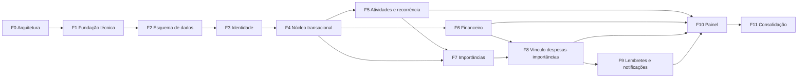

# Plano de fases da implementação — API MinhaVida

| Campo | Valor |
| --- | --- |
| Documento | `docs/arquitetura/plano_fases_api.md` |
| Estado | PROPOSTO. F1 **`APROVADO_COM_P3`** e integrada no commit `90412ec` (G6 cumprido em 2026-10-13). F2 **`APROVADO_COM_P3`** na auditoria de 2026-10-13, aguardando a integração por commit do usuário (G6 pendente). Demais fases dependem das decisões pendentes |
| Data | 2026-10-10. Atualizado em 2026-10-11 (nome da F8, escopo financeiro, gates da F1 e da F5) e em 2026-10-13 (estado da F1, P-DOC-07; G6 da F1 e preparação da F2; auditoria e fechamento documental da F2) |
| Relacionados | ADR-0001, ADR-0002, `arquitetura_api_minhavida.md`, `plano_validacao_auditoria.md`, `matriz_requisitos_api.md` |

> A numeração das fases (F0–F11) é independente da numeração das telas (1–11) e das tabelas (1–13).

## 1. Justificativa da divisão

Diferenças em relação à hipótese inicial do prompt da sessão:

1. **A fundação foi dividida em F1 (técnica) e F2 (esquema).** As decisões de sessão, transação, erros e testes atravessam todas as fases e merecem auditoria isolada. As 13 tabelas formam um bloco grande e mecânico, que se beneficia de uma infraestrutura de testes já aprovada.
2. **A idempotência e a trava do usuário (F4) vêm antes de qualquer cadastro de domínio.** A F3 (identidade) não precisa de idempotência: o registro é protegido pela unicidade do e-mail, e `requisicao_idempotente` exige `usuario_id`.
3. **Importâncias foram divididas em F7 (compromissos, recorrência e agendamento de lembretes) e F8 (vínculo interno entre despesas e importâncias).** F8 depende de F6 (financeiro) e de F7. Até 2026-10-11 a F8 se chamava “Integração de pagamentos”. O nome mudou porque a fase nunca previu integração externa: ela só registra o vínculo informado pelo usuário (REC-MV-028).
4. **O painel (F10) vem depois de todos os domínios.** Ele só reutiliza services, sem regras próprias, o que evita uma fase que antecipe capacidades futuras.

Nenhuma fase entrega comportamento que viole contrato para manter a sequência. Por exemplo, a F6 não aceita `importancia_id`: o campo só aparece na F8, numa mudança aditiva do contrato.

## 2. Grafo de dependências

Ordem de execução (sequencial, uma fase por vez): F1 → F2 → F3 → F4 → F5 → F6 → F7 → F8 → F9 → F10 → F11.

## 3. Resumo das fases

| Fase | Nome | Decisões exigidas (aceitas) | Estado atual |
| --- | --- | --- | --- |
| F0 | Arquitetura e reconciliação | — | ENTREGUE PARA REVISÃO (documentos desta sessão) |
| F1 | Fundação técnica | DEC-MV-01 a 05, DEC-MV-25 e DEC-MV-26 (**aprovadas** em 2026-10-11) | **`APROVADO_COM_P3`** (reauditoria de 2026-10-11). **Integrada** no commit `90412ec4b9ecb6594e0b9e571c1dbba0bb1a4a30` (G6 cumprido em 2026-10-13). P3 ACH-MV-F1-005, 006 e 007 encerrados em 2026-10-13, com as evidências da auditoria da F2 (`indice.md` §4, M13) |
| F2 | Esquema de dados | DEC-MV-06, 07, 08 e ACH-MV-F1-005, opção A (**aprovadas** em 2026-10-13). `CLAUDE.md` atualizado em 2026-10-13 | **`APROVADO_COM_P3`** na auditoria de 2026-10-13 (`docs/auditorias/AUDITORIA_F2_ESQUEMA_DADOS.md`). Aguardando a integração por commit do usuário (G6 pendente). P3: ACH-MV-F2-001 e 003 encerrados; ACH-MV-F2-002 em acompanhamento até o próximo Prompt Master. Histórico: Prompt F2 em `PRONTO_PARA_ETAPA_A` em 2026-10-13 |
| F3 | Identidade e acesso | DEC-MV-09 a 13 | AGUARDANDO_DECISAO |
| F4 | Núcleo transacional | DEC-MV-14, 15 | AGUARDANDO_DECISAO |
| F5 | Atividades e recorrência | DEC-MV-16 e DEC-MV-24 | AGUARDANDO_DECISAO |
| F6 | Financeiro | DEC-MV-17 | AGUARDANDO_DECISAO |
| F7 | Importâncias | DEC-MV-18, 19 | AGUARDANDO_DECISAO |
| F8 | Vínculo interno entre despesas e importâncias | (decisões de F6/F7) | PROPOSTO |
| F9 | Lembretes e notificações | DEC-MV-20 | AGUARDANDO_DECISAO |
| F10 | Painel inicial | (decisões anteriores) | PROPOSTO |
| F11 | Consolidação operacional | DEC-MV-21 (produção) | AGUARDANDO_DECISAO |

## 4. Regras comuns a todas as fases

| Item | Regra |
| --- | --- |
| Arquivos protegidos (nunca alterados pelo implementador) | `CLAUDE.md`; `docs/adr/*`; `docs/arquitetura/*`; `PROMPTS/*` (exceto o relatório, se o prompt pedir um arquivo); `.env` (o usuário edita); migrações já aplicadas de fases anteriores; `uv.lock` (somente via `uv add`/`uv sync`) |
| Etapa A | Somente leitura: confrontar baseline, prompt e código; apresentar o plano de arquivos e comandos; aguardar “pode implementar” |
| Relatório | `plano_validacao_auditoria.md` §6 |
| Auditoria | Protocolo §9. O Opus não corrige durante a auditoria |
| Commit/merge | LOCAL: proibido ao implementador. Cloud: conforme §10 do plano de validação |
| Parada | Ao fim da implementação e da validação, o implementador para e encaminha à auditoria. A fase seguinte exige um novo Prompt Master gerado no baseline real e uma nova autorização |
| Rollback de código | Fases sem commit: o usuário descarta as alterações (somente ele). Com commit: `git revert` decidido pelo usuário |
| Escopo do produto | Financeiro manual, com totais calculados e sem integrações financeiras externas (arquitetura §1.1, REC-MV-028). Nenhuma fase cria dependência, tabela, configuração ou abstração para essas integrações |

---

## 5. Fichas das fases

### F0 — Arquitetura e reconciliação

1. **Objetivo:** baseline, reconciliação normativa, ADRs, contratos, plano de fases, plano de validação e o Prompt Master da F1.
2. **Fontes:** `CLAUDE.md` e prompt anterior do banco.
3. **Gate de entrada:** G0 (cumprido nesta sessão).
4. **Requisitos:** todos (mapeamento em `matriz_requisitos_api.md`).
5. **Endpoints:** contratos em `arquitetura_api_minhavida.md` §9.
6. **Esquema:** catálogo em §10 e ADR-0002.
7. **Transações:** §5 e §6.
8. **Arquivos:** novos em `docs/` e `PROMPTS/PROMPT_MASTER_SONNET_5_F1_FUNDACAO_API.md`. Nenhum código.
9. **Testes:** nenhum executado. Catálogo planejado.
10. **Comandos:** somente leitura e verificação documental.
11. **Aceite:** critérios do prompt da sessão (§16), revisados no índice.
12. **Auditoria:** revisão do usuário (e, se desejado, do GPT-6 Astra).
13. **Rollback:** remover os documentos novos (decisão do usuário).
14. **Parada:** aguardar aprovação das DEC. A F1 só avança com DEC-MV-01 a 05 e DEC-MV-25 aceitas (todas aceitas em 2026-10-11).

### F1 — Fundação técnica

1. **Objetivo:** aplicação FastAPI sem efeitos de importação; configuração; ciclo de sessão e fronteira transacional; contrato de erros; saúde; rastreamento; Alembic async vazio; infraestrutura de testes com Testcontainers; higiene do repositório.
   - **Valor:** base auditável sobre a qual toda escrita futura é atômica e testável.
2. **Baseline:** commit de baseline do usuário com os 22 arquivos de `analise_projeto_minhavida.md` §3.5, sem o `compose.yaml`. Ele é **exigido antes da Etapa B** (ACH-MV-ARQ-019, P2, REC-MV-031 e 032), salvo exceção aceita explicitamente pelo usuário. Se a Etapa A ocorrer antes do commit, a Etapa B começa pela revalidação do baseline (Prompt F1 §1.2). Até o commit, os hashes de §3.2 servem de referência.
   - **Decisões:** DEC-MV-01 a 05 e DEC-MV-25 (convenção de nomes, escopo limitado), aprovadas em 2026-10-11.
3. **Dependências:** F0 aprovada.
   - **Gate:** G1 para D-01 a D-04, D-08 e D-14 (aceitas em 2026-10-11; cobrem também o ambiente Alembic sem revisões, ADR-0001 §3) e para a convenção de nomes de D-09 (aceita por DEC-MV-25). G1 cumprido. Depois, G2 (Prompt Master F1), também cumprido em 2026-10-11.
4. **Requisitos:** transversais (5.5.2, 7.4.7, 9.3.6 e 4.2.8 na forma de erro estruturado). Contrato: MAP (Alembic async).
   - **Fora do escopo:** tabelas, autenticação, qualquer endpoint de negócio.
5. **Endpoints:** `GET /saude` e `GET /saude/pronto`. Remoção de `GET /`.
6. **Esquema:** nenhuma tabela. `MetaData` com convenção de nomes. Alembic sem revisões.
7. **Transações:** `obter_sessao`/`SessaoDep` com `scope="function"`, commit no router, mapeamento de SQLSTATE e timeouts por conexão.
8. **Arquivos:** lista exata no Prompt Master F1 §7.
9. **Testes:** CT-F1-01 a CT-F1-20 (`tests/infra/`). Concorrência: CT-F1-15.
10. **Comandos:** Prompt Master F1 §14.
11. **Aceite:** todos os CT passam; Ruff e Pyright limpos; `docker compose config` válido sem segredos literais; nenhum arquivo protegido alterado.
    - **Reprovação:** commit fora do router; `create_all`; segredo no repositório; teste pulado por falta de Docker.
12. **Auditoria:**
    - commit só em router e jobs;
    - ausência de I/O na importação;
    - handler sem eco de entrada;
    - teste de commit diferido realmente falha no commit;
    - guarda de banco.
13. **Rollback:** sem dados. Revertido pelo usuário.
14. **Parada:** entrega para auditoria. A F2 exige DEC-MV-06 a 08 e o `CLAUDE.md` atualizado.

### F2 — Esquema de dados

1. **Objetivo:** 13 modelos com UUIDv7, migração inicial completa, 30 seeds e testes de integridade.
   - **Valor:** um esquema estável e verificado para todas as fases.
2. **Decisões:** DEC-MV-06 (ADR-0002), DEC-MV-07 e DEC-MV-08, e a opção A do ACH-MV-F1-005, todas aprovadas em 2026-10-13.
   - **Fontes:** `CLAUDE.md` **atualizado** em 2026-10-13 (diff de ADR-0002, DEC-MV-07 e DEC-MV-08) e arquitetura §10.
3. **Dependências:** F1 aprovada e integrada. **Cumprido:** baseline `90412ec4b9ecb6594e0b9e571c1dbba0bb1a4a30` (G6 da F1, 2026-10-13).
4. **Requisitos:** T-01 a T-13, RI-1 a RI-9 (parte estrutural), IDX e MAP.
   - **Fora do escopo:** regras de serviço (§9 do prompt anterior), endpoints.
5. **Endpoints:** nenhum.
6. **Esquema:**
   - `models/enums.py`, os 13 arquivos de modelo, `CriadoAtualizadoMixin` (substitui `TimestampMixin`), `eager_defaults`;
   - revisão `alembic/versions/<AAAAMMDD>_0001_esquema_inicial.py` (ID `0001`) com tabelas, constraints, índices e seeds idempotentes;
   - `requires-python` já ajustado na F1.
7. **Transações:** somente nos testes. Seeds com `ON CONFLICT DO NOTHING`.
8. **Arquivos:** `src/api_gestao_pessoal/models/*`, `alembic/versions/*` (nova), `tests/esquema/*`, `tests/conftest.py` (fixture de migração por sessão), `tests/apoio/*` (limpeza e apoio de esquema), `tests/infra/test_alembic_ambiente.py` (CT-F1-17) e `pyproject.toml` (somente as três alterações do ACH-MV-F1-005, opção A). Lista exata no Prompt F2 §7.
9. **Testes:** CT-F2-01 a CT-F2-20 (CT-F2-20 é obrigatório desde a aprovação de DEC-MV-08).
   - **Regressões:** CT-F1-17 a CT-F1-19 (agora com revisão) e CT-F1-02 (importação dos modelos sem efeitos).
10. **Comandos:** literais no Prompt F2 §13, com saída integral preservada em arquivo de log. Resumo:
    - `uv run pytest tests/esquema -q`;
    - `uv run pytest tests/infra/test_alembic_ambiente.py tests/infra/test_configuracao.py::test_importacao_sem_efeitos -q`;
    - verificação Ruff e Pyright, agora incluindo `alembic/`;
    - `uv run alembic heads` (1 head: `0001`);
    - `docker compose --env-file /dev/null config --quiet`, com variáveis fictícias (lição da F1, ACH-MV-F1-007).
11. **Aceite:** introspecção literal das 134 colunas; todas as constraints com controles positivo e negativo (inclusive `NULL`); 30 seeds; `check` limpo.
    - **Reprovação:** comparar o metadata consigo mesmo; ausência de casos `NULL`; nome > 63 caracteres; FK com CASCADE.
12. **Auditoria:** conferência campo a campo com o contrato; SQL gerado em modo offline somente pela API do Alembic (`command.upgrade(cfg, "head", sql=True)`), com `config.attributes["url_banco"]` fictícia, `configurar_logging=False` e saída capturada fora do repositório; nunca `alembic upgrade --sql` pela CLI, que carregaria as configurações reais; seeds sem importar modelos vivos.
13. **Rollback:** `downgrade base` somente em banco descartável. No desenvolvimento, sem dados.
14. **Parada:** auditoria. A F3 exige DEC-MV-09 a 13.

### F3 — Identidade e acesso

1. **Objetivo:** registro, login JWT, contexto do usuário e relógio, `GET /usuarios/me`, recuperação de senha em 3 etapas com e-mail, utilitário de autorização.
   - **Valor:** usuários reais e autenticação segura.
2. **Decisões:** DEC-MV-09 a 13.
3. **Dependências:** F2. Novas dependências: `argon2-cffi`, `PyJWT`, `tzdata` (via `uv add`, versões fixadas no lock no momento da fase).
4. **Requisitos:** 1.1, 2.1, 3 (3.1.1, 3.2.1, 3.2-reenvio, 3.2-regra, 3.3.1*, 3.4.1–3.4.15), 4.1.1 (nome).
   - **Fora do escopo:** perfil e alteração de fuso (DEC-MV-13), logout no servidor, limitação de login (F11).
5. **Endpoints:** arquitetura §9.1.
6. **Esquema:** nenhuma alteração.
7. **Transações e efeitos:**
   - registro sem trava, protegido pela unicidade;
   - recuperação com `FOR UPDATE`;
   - a verificação persiste a tentativa antes de recusar (§5.3);
   - e-mail enviado antes do commit (D-15).
8. **Arquivos:**
   - `tempo.py`, `seguranca.py`, `email.py`, `dependencias.py`;
   - `services/identidade.py`, `services/recuperacao_senha.py`, `services/autorizacao.py`;
   - `schemas/autenticacao.py`, `schemas/usuario.py`;
   - `routers/autenticacao.py`, `routers/usuarios.py`;
   - `settings.py` (novas variáveis), `erros.py` (novos códigos), `main.py` (routers);
   - `.env.exemplo`, `tests/identidade/*`.
9. **Testes:** CT-F3-01 a CT-F3-21, CT-F3-25 e CT-F3-30. Concorrência: CT-F3-05, 14, 15, 17 e 19.
10. **Comandos:** `uv run pytest tests/identidade -q`, mais a regressão `tests/infra/test_erros.py`, e a verificação de qualidade.
11. **Aceite:** mensagens literais de 3.4.8, 3.4.10, 3.4.14 e 3.4.15; nenhum segredo em log ou resposta; tentativas persistidas.
12. **Auditoria:**
    - tempo constante no login;
    - `verify_exp` manual com o relógio;
    - código como texto;
    - hash lento do código;
    - SHA-256 só para o token de alta entropia.
13. **Rollback:** reverter o código. Dados de usuários de teste apenas.
14. **Parada:** auditoria. A F4 exige DEC-MV-14 e 15.

### F4 — Núcleo transacional compartilhado

1. **Objetivo:**
   - trava do usuário (`services/trava.py`);
   - idempotência (`services/idempotencia.py`, `ChaveIdempotenciaDep`);
   - paginação keyset (`services/paginacao.py`);
   - tipos comuns de schema (`schemas/comum.py`);
   - endpoints de catálogos.
2. **Decisões:** DEC-MV-14 e 15.
3. **Dependências:** F3 (contexto autenticado).
4. **Requisitos:** 6.3.1, 6.5.6, 8.4.1, 8.6.6, 10.3.1, 10.4.6, 10.5.5, 11.3.1, 11.4.6 e 11.6.4 (mecanismo); 5.1.3, 7.1.4 e 9.1.4 (catálogos); 5.1.6, 5.5.8 e 9.1.6 (paginação).
   - **Fora do escopo:** cadastros de domínio. O mecanismo é testado por rota de teste em `tests/apoio/`.
5. **Endpoints:** arquitetura §9.2.
6. **Esquema:** nenhuma alteração.
7. **Transações:** protocolo §8.4 e trava §6.1.
8. **Arquivos:**
   - `services/trava.py`, `services/idempotencia.py`, `services/paginacao.py`, `services/categorias.py`;
   - `schemas/comum.py`, `schemas/categoria.py`;
   - `routers/categorias.py`;
   - `dependencias.py`, `erros.py`;
   - `tests/nucleo/*`, `tests/apoio/rotas_teste.py`.
9. **Testes:** CT-F4-01 a CT-F4-14. Concorrência: 01, 02, 05 e 06.
10. **Comandos:** `uv run pytest tests/nucleo -q` e verificação de qualidade.
11. **Aceite:** replay byte a byte idêntico no corpo JSON; nenhum efeito duplicado; trava liberada no commit e no rollback.
12. **Auditoria:** a trava é obtida antes de qualquer leitura de decisão; não existe caminho em que `EM_PROCESSAMENTO` seja confirmado.
13. **Rollback:** reverter o código.
14. **Parada:** auditoria. A F5 exige DEC-MV-16 e DEC-MV-24.

### F5 — Atividades e recorrência

1. **Objetivo:**
   - cálculo puro de recorrência e materialização genérica;
   - CRUD de atividades com alcance;
   - consulta do dia com indicadores e paginação;
   - pendências anteriores;
   - conclusão e reabertura.
2. **Decisões:** DEC-MV-16 e DEC-MV-24 (importações entre services, REC-MV-029).
3. **Dependências:** F4.
4. **Requisitos:** tela 5 (5.1.*–5.5.*), tela 6 (6.1.*–6.5.*), REP (atividades) e 4.2.5 (ação reutilizada pelo painel).
   - **Fora do escopo:** o bloco do painel (F10).
5. **Endpoints:** arquitetura §9.3.
6. **Esquema:** nenhuma alteração.
7. **Transações:** trava EXCLUSIVA em consultas materializadoras (com commit) e escritas. Idempotência no `POST`.
8. **Arquivos:**
   - `services/recorrencia.py`, `services/atividades.py`;
   - `schemas/atividade.py`, `routers/atividades.py`;
   - `main.py` (router);
   - `tests/atividades/*`.
9. **Testes:** CT-F5-01 a CT-F5-15 e CT-F5-20 a CT-F5-31. Concorrência: 24 a 27. Puro: 20.
10. **Comandos:**
    - `uv run pytest tests/atividades -q`;
    - regressões: `tests/nucleo/test_idempotencia.py` e `tests/nucleo/test_trava.py`;
    - verificação de qualidade.
11. **Aceite:** exemplos numéricos 5.5.3, 5.5.4 e 6.5.5; invariantes I-REC-1 a I-REC-5 provados.
12. **Auditoria:** caminhos de escrita sem trava; materialização sem commit; edição de alcance pela posição original.
13. **Rollback:** reverter o código. Dados sem migração.
14. **Parada:** auditoria. A F6 exige DEC-MV-17.

### F6 — Financeiro

1. **Objetivo:** receitas e despesas sem vínculo; consulta de movimentações; resumo mensal (totais, gráfico, categorias, comparação); edição e exclusão.
2. **Decisões:** DEC-MV-17.
3. **Dependências:** F4 (pode ser executada depois da F5, como no plano sequencial).
4. **Requisitos:** telas 9 e 10 completas; tela 11, exceto 11.2.4 e 11.5.* (F8); 4.2.2 (função `totais_periodo`); escopo financeiro da arquitetura §1.1.
   - **Fora do escopo:** integrações financeiras externas e qualquer saldo informado manualmente (arquitetura §1.1).
5. **Endpoints:** arquitetura §9.4, sem `importancia_id` e sem `disponiveis-vinculo`.
6. **Esquema:** nenhuma alteração.
7. **Transações:** EXCLUSIVA na escrita, COMPARTILHADA no resumo e nas listas. Idempotência em receitas e despesas.
8. **Arquivos:**
   - `services/financeiro.py`, `services/resumo_financeiro.py`;
   - `schemas/financeiro.py`, `routers/financeiro.py`;
   - `tests/financeiro/*`.
9. **Testes:** CT-F6-01 a CT-F6-14 e CT-F6-20.
10. **Comandos:** `uv run pytest tests/financeiro -q`, mais regressões do núcleo e verificação de qualidade.
11. **Aceite:** valores exatos 9.4.1, 9.4.3 e 9.4.5; exemplo de referência do usuário (CT-F6-14); nenhum uso de `float` (auditoria por busca no diff).
12. **Auditoria:** precisão decimal, intervalos de comparação e coerência gráfico = categorias = totais.
13. **Rollback:** reverter o código.
14. **Parada:** auditoria. A F7 exige DEC-MV-18 e 19.

### F7 — Importâncias

1. **Objetivo:**
   - CRUD de importâncias com recorrência (inclusive anual);
   - filtros e grupos;
   - conclusão manual;
   - agendamento e ciclo de vida dos lembretes (sem processamento);
   - migração aditiva `DESATIVADO`, se DEC-MV-19 for aprovada.
2. **Decisões:** DEC-MV-18 e 19.
3. **Dependências:** F5 (motor de recorrência) e F4.
4. **Requisitos:** tela 7 (exceto 7.3.5–7.3.7, que vão para a F8); tela 8 (8.5.6: agendamento; a notificação fica na F9).
5. **Endpoints:** arquitetura §9.5, exceto `pagamento` e `disponiveis-pagamento`.
6. **Esquema:** se DEC-MV-19 for aprovada, nova revisão alterando `ck_lembrete_importancia_situacao` e o `Enum` (reversível).
7. **Transações:** EXCLUSIVA, idempotência no `POST`, lembretes sob a mesma transação.
8. **Arquivos:**
   - `services/situacao_importancia.py`, `services/importancias.py`, `services/lembretes.py`;
   - `schemas/importancia.py`, `routers/importancias.py`;
   - `models/enums.py` (se DEC-MV-19);
   - nova migração (se DEC-MV-19);
   - `tests/importancias/*`.
9. **Testes:** CT-F7-01 a CT-F7-18 (sem a parte de pagamento de CT-F7-18). Concorrência: 17.
10. **Comandos:** `uv run pytest tests/importancias -q`, mais regressões `tests/atividades/test_recorrencia_calculo.py` e `tests/esquema` (se houver migração), e verificação de qualidade.
11. **Aceite:** exemplos 8.6.4 e 8.6.5; horizonte; versões de lembrete.
12. **Auditoria:** cálculo de `agendado_para` no fuso; reabertura × desativado.
13. **Rollback:** migração aditiva com `downgrade` (somente se nenhum lembrete estiver `DESATIVADO`).
14. **Parada:** auditoria. Segue para a F8.

### F8 — Vínculo interno entre despesas e importâncias

1. **Objetivo:** registrar, como informação do usuário, que uma importância foi paga, por meio de uma despesa nova ou existente vinculada a ela. Nenhuma operação financeira é executada. Itens:
   - despesa com `importancia_id` (registrar pagamento);
   - vincular despesa existente;
   - trocar e remover vínculo;
   - efeitos da exclusão de despesa e de importância;
   - consultas de disponíveis;
   - categoria sugerida.
2. **Decisões:** as de F6 e F7.
3. **Dependências:** F6 e F7.
4. **Requisitos:** 7.3.5–7.3.8, 7.4.5, 7.4.6, 8.5.3, 8.5.8, 8.6.3, 9.3.1 (importância vinculada), 9.3.3, 9.3.4, 9.4.7, 11.2.4, 11.3.1 (rótulo: cliente), 11.4.5, 11.5.1–11.5.7, 11.6.3–11.6.7, RI-4 a RI-7.
   - **Regras de escopo:** o valor previsto não é contabilizado como gasto (8.5.3); a despesa criada ou vinculada entra nos totais uma única vez (9.2.1, 11.6.4); vincular uma despesa existente não duplica o lançamento nem altera o total.
   - **Fora do escopo:** execução de pagamentos e qualquer integração externa (arquitetura §1.1).
5. **Endpoints:** acréscimos de §9.4 e §9.5 (aditivos).
6. **Esquema:** nenhuma alteração.
7. **Transações:** §8.7. Uma transação por operação. Matriz §6.6, linhas 8 a 12.
8. **Arquivos:**
   - `services/pagamentos.py`;
   - `services/financeiro.py` (exclusão vinculada);
   - `services/importancias.py` (exclusão com desvínculo, `possui_despesa`);
   - `schemas/financeiro.py`, `schemas/importancia.py`;
   - `routers/financeiro.py`, `routers/importancias.py`;
   - `tests/pagamentos/*`.
9. **Testes:** CT-F8-01 a CT-F8-16. Concorrência: 05 a 09.
10. **Comandos:** `uv run pytest tests/pagamentos -q`, mais regressões `tests/financeiro`, `tests/importancias/test_situacao.py` e `test_exclusao.py`, e verificação de qualidade.
11. **Aceite:** valores 11.6.3–11.6.5; nenhuma despesa duplicada; atomicidade provada por falha injetada.
12. **Auditoria:** nenhum caminho deixa vínculo com despesa excluída ou com importância excluída; o ciclo `financeiro → pagamentos` está ausente.
13. **Rollback:** reverter o código.
14. **Parada:** auditoria. A F9 exige DEC-MV-20.

### F9 — Lembretes e notificações

1. **Objetivo:** processador (materialização antecipada e envio de notificações internas), endpoints de notificações e ponto de entrada CLI.
2. **Decisões:** DEC-MV-20.
3. **Dependências:** F8.
4. **Requisitos:** 4.1.9, 8.3.4 (efeito), 8.5.6 (geração de notificação), RI-5 (notificações legíveis), tabelas 11 e 12 (comportamento).
5. **Endpoints:** arquitetura §9.6.
6. **Esquema:** nenhuma alteração.
7. **Transações:** o job é dono da transação (uma por série e uma por lembrete). `SKIP LOCKED`.
8. **Arquivos:**
   - `jobs/__init__.py`, `jobs/processar_lembretes.py`;
   - `services/processamento_lembretes.py`, `services/notificacoes.py`;
   - `schemas/notificacao.py`, `routers/notificacoes.py`;
   - `settings.py`;
   - `tests/lembretes/*`.
9. **Testes:** CT-F9-01 a CT-F9-09. Concorrência: 04 a 06.
10. **Comandos:** `uv run pytest tests/lembretes -q`, mais regressão `tests/importancias/test_lembretes_agendamento.py`, e verificação de qualidade.
11. **Aceite:** uma notificação por versão; nada retroativo; falha isolada por item.
12. **Auditoria:** o processador nunca trava a importância; a revalidação da versão ocorre depois da trava de linha.
13. **Rollback:** parar o processo do job. Notificações já geradas permanecem (histórico).
14. **Parada:** auditoria. Segue para a F10.

### F10 — Painel inicial

1. **Objetivo:** os blocos do painel, reutilizando services.
2. **Decisões:** anteriores.
3. **Dependências:** F5, F6, F8 e F9.
4. **Requisitos:** tela 4 (4.1.*, 4.2.*, 4.3.*).
5. **Endpoints:** arquitetura §9.7.
6. **Esquema:** nenhuma alteração.
7. **Transações:** COMPARTILHADA (financeiro) e EXCLUSIVA (atividades e importâncias).
8. **Arquivos:** `services/painel.py`, `schemas/painel.py`, `routers/painel.py` e `tests/painel/*`.
9. **Testes:** CT-F10-01 a CT-F10-08.
10. **Comandos:** `uv run pytest tests/painel -q` e verificação de qualidade.
11. **Aceite:** 4.3.1–4.3.7 com valores exatos.
12. **Auditoria:** ausência de regra duplicada (o painel chama as mesmas funções das telas 5, 7 e 9).
13. **Rollback:** reverter o código.
14. **Parada:** auditoria. Segue para a F11.

### F11 — Consolidação operacional

1. **Objetivo:**
   - integração dirigida ponta a ponta;
   - medição de desempenho com volume representativo;
   - revisão de índices por `EXPLAIN`;
   - settings de produção;
   - documentação de operação (deploy, migração, backup, job, limitação de login na borda);
   - riscos remanescentes.
2. **Decisões:** DEC-MV-21 e escolha da plataforma de deploy (nova decisão a registrar).
3. **Dependências:** F10.
4. **Requisitos:** transversais. Nenhum requisito essencial de tela fica para esta fase: todos estão entregues em F3–F10.
5. **Endpoints:** nenhum novo.
6. **Esquema:** índices adicionais somente com evidência e aprovação.
7. **Transações:** sem mudanças.
8. **Arquivos:** `tests/integracao/*`, `tests/desempenho/*` (marcador `performance`), `docs/operacao/*` (novo, aprovado na fase).
9. **Testes:** CT-F11-01 a CT-F11-03.
10. **Comandos:**
    - `uv run pytest tests/integracao -q`;
    - `uv run pytest tests/desempenho -m performance -q`, separado e sem Pyright em paralelo.
11. **Aceite:** metas validadas ou ajustadas com aprovação; checklist de produção.
12. **Auditoria:** a medição é reprodutível.
13. **Rollback:** —
14. **Parada:** fim do plano.

---

## 6. Cobertura por fase

| Tela/área | F1 | F2 | F3 | F4 | F5 | F6 | F7 | F8 | F9 | F10 |
| --- | --- | --- | --- | --- | --- | --- | --- | --- | --- | --- |
| 1 Login |  |  | ● |  |  |  |  |  |  |  |
| 2 Registro |  |  | ● |  |  |  |  |  |  |  |
| 3 Recuperação |  |  | ● |  |  |  |  |  |  |  |
| 4 Inicial |  |  | ○ (nome) | ○ (catálogos) | ○ (ação) | ○ (totais) |  |  | ○ (notificações) | ● |
| 5 Atividades |  |  |  | ○ | ● |  |  |  |  |  |
| 6 Cadastro de atividade |  |  |  | ○ (idempotência) | ● |  |  |  |  |  |
| 7 Importâncias |  |  |  | ○ | ○ (motor) |  | ● | ● (vínculo) |  |  |
| 8 Cadastro de importância |  |  |  | ○ |  |  | ● | ○ (8.5.8 pago) | ○ (notificação) |  |
| 9 Financeiro |  |  |  | ○ |  | ● |  | ○ (vínculos) |  |  |
| 10 Receita |  |  |  | ○ |  | ● |  |  |  |  |
| 11 Despesa |  |  |  | ○ |  | ● |  | ● |  |  |
| Contrato de tabelas | ○ (Alembic) | ● |  |  |  |  | ○ (DESATIVADO) |  |  |  |
| Transversais (erros, transação, segurança) | ● | ○ | ● | ● | ○ | ○ | ○ | ○ | ○ | ○ |

Legenda: ● entrega principal; ○ entrega parcial ou de suporte. O detalhe por requisito está em `matriz_requisitos_api.md`.
